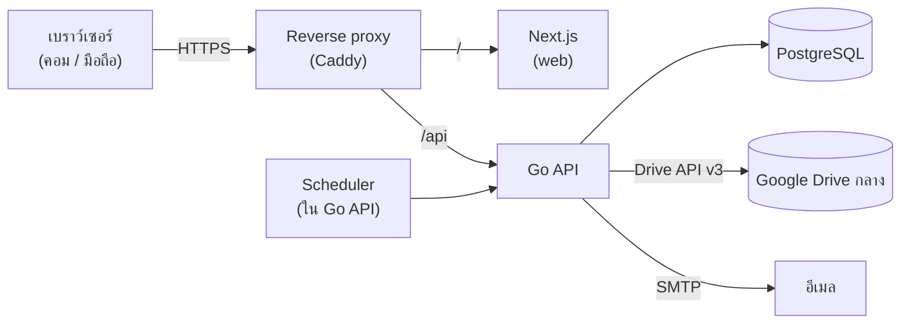
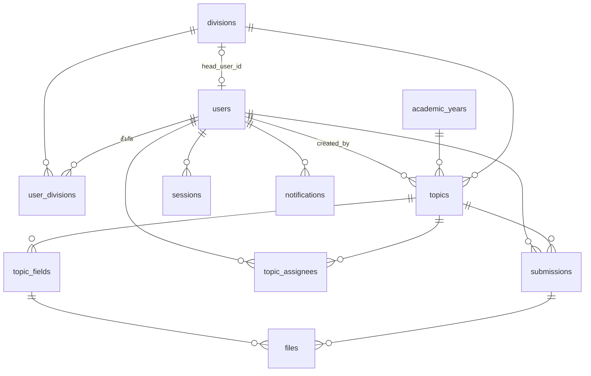

# SDMS — เอกสารทางเทคนิคและแผนงานพัฒนา

Technical Design & Development Task Plan

| | |
|---|---|
| ระบบ | SDMS — School Document Management System |
| รุ่นเอกสาร | 1.0 · 10 ต.ค. 2569 |
| เทคโนโลยี | Go (API) · Next.js (Web) · PostgreSQL · Google Drive (เก็บไฟล์) |
| ทีม | 2–3 คน |
| ต้นแบบอ้างอิง | https://claude.ai/artifact/6j9Vof6oUJjZNQWMWueyp2 (v0.4) |
| ระยะเวลาโดยประมาณ | 12 สัปดาห์ (ทีม 3 คน) |

> ต้นแบบเป็นข้อกำหนดด้านหน้าจอและพฤติกรรม ถ้าเอกสารนี้กับต้นแบบขัดกัน ให้ยึดเอกสารนี้แล้วแจ้งทีมเพื่อแก้อีกฝั่ง

---

## สารบัญ

1. [ขอบเขต](#1-ขอบเขต)
2. [สถาปัตยกรรม](#2-สถาปัตยกรรม)
3. [เทคโนโลยีและไลบรารี](#3-เทคโนโลยีและไลบรารี)
4. [บทบาทและสิทธิ์](#4-บทบาทและสิทธิ์)
5. [ฐานข้อมูล](#5-ฐานข้อมูล)
6. [API](#6-api)
7. [กติกาของระบบ](#7-กติกาของระบบ)
8. [การเชื่อม Google Drive](#8-การเชื่อม-google-drive)
9. [Frontend](#9-frontend)
10. [ความปลอดภัยและข้อกำหนดอื่น](#10-ความปลอดภัยและข้อกำหนดอื่น)
11. [เรื่องที่ต้องตัดสินใจก่อนเริ่ม](#11-เรื่องที่ต้องตัดสินใจก่อนเริ่ม)
12. [โครง Repository และการตั้งค่า](#12-โครง-repository-และการตั้งค่า)
13. [Task Plan](#13-task-plan)
14. [ความเสี่ยง](#14-ความเสี่ยง)

---

## 1. ขอบเขต

### 1.1 อยู่ในขอบเขต (MVP)

| กลุ่ม | ความสามารถ |
|---|---|
| เข้าสู่ระบบ | อีเมล + รหัส OTP, เข้าได้เฉพาะอีเมลในรายชื่อบุคลากร |
| หัวข้อ | หัวหน้าฝ่าย/แอดมินสร้างหัวข้อพร้อมฟอร์ม 6 ชนิดช่อง, แก้ไข, ปิด/เปิดรับ, ลบ, หัวข้อลับ |
| การส่ง | กรอกฟอร์ม + แนบไฟล์ (≤ 50 MB/ไฟล์), แก้ไขได้จนปิดรับ |
| ตารางคำตอบ | แถว = ทุกคนที่ต้องส่ง, คอลัมน์ = ช่องในฟอร์ม, กรองสถานะ, เปิดไฟล์ |
| หน้าแรก | แบบผู้บริหาร/หัวหน้าฝ่าย (ภาพรวม 1 + 4 ฝ่าย) และแบบครู (ต้องส่ง, ของฉัน, ส่งล่าสุด) |
| หน้าฝ่าย | สถิติ (โดนัท), ต้องส่ง, การ์ดหัวข้อ, กรองปี |
| แฟ้มของฉัน | รายการที่ตัวเองส่งตามปี, ค้นหา, ดาวน์โหลด .zip |
| ค้นหา | ค้นข้อความ + กรองฝ่าย / ปี / ภาคเรียน / ผู้ส่ง |
| แจ้งเตือน | อีเมลเมื่อมีหัวข้อใหม่, ปุ่มเตือน, เตือนอัตโนมัติก่อนครบกำหนด |
| จัดการระบบ | บุคลากร (รวมนำเข้า CSV), หัวหน้าฝ่าย, ปีการศึกษา |
| หน้าตา | โหมดสว่าง/มืด/ตามเครื่อง, รองรับมือถือ, สไตล์ตามต้นแบบ |

### 1.2 นอกขอบเขต (ทำในรุ่นถัดไปถ้าต้องการ)

- แอปมือถือแบบติดตั้ง (ใช้เว็บบนมือถือแทน)
- แจ้งเตือนผ่าน LINE หรือช่องทางอื่นนอกจากอีเมล
- หลายโรงเรียนในระบบเดียว
- ลายเซ็นอิเล็กทรอนิกส์ / ขั้นตอนอนุมัติเอกสาร
- ย้ายข้อมูลเก่าจาก Google Drive เดิมเข้าระบบอัตโนมัติ

---

## 2. สถาปัตยกรรม



| ส่วน | หน้าที่ |
|---|---|
| Reverse proxy | HTTPS, ส่ง `/api/*` ไป Go และที่เหลือไป Next.js — ทั้งสองอยู่โดเมนเดียวกัน cookie จึงเป็น first-party |
| Next.js | หน้าจอทั้งหมด เรียก API จากเบราว์เซอร์ (ไม่เก็บ business logic) |
| Go API | business logic, สิทธิ์, คุยกับ PostgreSQL / Drive / SMTP, งานตามเวลา |
| PostgreSQL | ข้อมูลทั้งหมด ยกเว้นตัวไฟล์ |
| Google Drive | เก็บไฟล์จริง ผู้ใช้ไม่เข้าถึง Drive โดยตรง ทุกการเปิดไฟล์ผ่าน API |
| SMTP | ส่ง OTP และการแจ้งเตือน |

**หลักการ**

- สิทธิ์ตรวจที่ Go API เท่านั้น หน้าเว็บซ่อนปุ่มตามสิทธิ์เพื่อความสะดวก แต่ไม่ถือเป็นการป้องกัน
- ไฟล์ทุกไฟล์อยู่ใน Drive ของโรงเรียน ระบบเป็นผู้สร้างและเป็นเจ้าของ ครูไม่ต้องแชร์ลิงก์
- เวลาและวันที่ทั้งหมดคิดตามเขตเวลา `Asia/Bangkok`

---

## 3. เทคโนโลยีและไลบรารี

| ชั้น | ที่ใช้ | หมายเหตุ |
|---|---|---|
| ภาษา backend | Go 1.22 ขึ้นไป | |
| HTTP router | `go-chi/chi` | middleware: request id, logging, recover, auth |
| ฐานข้อมูล | PostgreSQL 16 ขึ้นไป + `jackc/pgx` v5 | extension `pgcrypto`, `citext` |
| Query | `sqlc` | เขียน SQL เอง generate เป็น Go |
| Migration | `golang-migrate` | ไฟล์ใน `services/api/db/migrations` |
| Google Drive | `google.golang.org/api/drive/v3` | |
| Log | `log/slog` (JSON) | |
| Validation | เขียนเองตามชนิดช่อง + `go-playground/validator` สำหรับ request | |
| Frontend | Next.js (App Router) + TypeScript | |
| ดึงข้อมูล | TanStack Query | |
| ฟอร์ม | react-hook-form + zod | ใช้ schema เดียวกับรูปแบบ error ของ API |
| สไตล์ | CSS variables (design tokens) + CSS Modules | ยกค่าจากต้นแบบ หัวข้อ 9.3 |
| กราฟ | SVG เขียนเอง (โดนัท) | ไม่ต้องใช้ไลบรารีกราฟ |
| ฟอนต์ | Anuphan, IBM Plex Sans Thai | |
| ทดสอบ | `go test` + testcontainers-go, Playwright (E2E), Vitest (FE unit) | |
| CI | GitHub Actions | |
| รันระบบ | Docker + Docker Compose, Caddy | ดู D-07 |
| อีเมลตอน dev | Mailpit | |

---

## 4. บทบาทและสิทธิ์

### 4.1 บทบาท

| บทบาท | กำหนดจาก |
|---|---|
| ครู | ผู้ใช้ที่ไม่ใช่ผู้บริหาร |
| หัวหน้าฝ่าย | `divisions.head_user_id` (ฝ่ายละ 1 คน) |
| แอดมินกลาง | `users.is_admin` |
| ผู้บริหาร | `users.is_exec` |

คนเดียวมีได้หลายบทบาท (เช่น ครู + แอดมินกลาง)

### 4.2 ตารางสิทธิ์ → ฟังก์ชันใน `internal/policy`

| ฟังก์ชัน | อนุญาตเมื่อ |
|---|---|
| `MustSubmit(u)` | `!u.IsExec` และบัญชียังใช้งานอยู่ |
| `CanCreateTopic(u, div)` | `u.IsAdmin` หรือ `u` เป็นหัวหน้าของ `div` |
| `CanEditTopic(u, t)` | `u.IsAdmin` หรือหัวหน้าฝ่ายของ `t` หรือ `t.CreatedBy == u.ID` |
| `CanSeeAllResponses(u, t)` | `!t.IsSecret` หรือ `u.IsExec` หรือหัวหน้าฝ่ายของ `t` หรือ `t.CreatedBy == u.ID` |
| `CanSubmit(u, t)` | `MustSubmit(u)` และ `u` อยู่ใน `topic_assignees` ของ `t` และ `t.IsOpen` |
| `CanSeeOverview(u)` | `u.IsExec` หรือเป็นหัวหน้าฝ่ายใดฝ่ายหนึ่ง |
| `CanSeeDivisionStats(u, div)` | `u.IsExec` หรือ `u` เป็นหัวหน้าของ `div` |
| `CanAdmin(u)` | `u.IsAdmin` |
| `CanReadFile(u, f)` | เป็นเจ้าของไฟล์ หรือ `CanSeeAllResponses(u, topic)` |

ทุก endpoint ต้องเรียก policy ก่อนอ่าน/เขียนข้อมูล และมี unit test ครอบทุกแถวของตารางนี้ (P2-03)

---

## 5. ฐานข้อมูล

### 5.1 ภาพรวมตาราง



### 5.2 DDL

```sql
CREATE EXTENSION IF NOT EXISTS pgcrypto;
CREATE EXTENSION IF NOT EXISTS citext;

CREATE TABLE users (
  id             uuid PRIMARY KEY DEFAULT gen_random_uuid(),
  email          citext NOT NULL UNIQUE,
  full_name      text   NOT NULL,
  position       text   NOT NULL DEFAULT 'ครู',
  is_exec        boolean NOT NULL DEFAULT false,
  is_admin       boolean NOT NULL DEFAULT false,
  deactivated_at timestamptz,
  created_at     timestamptz NOT NULL DEFAULT now()
);

CREATE TABLE divisions (
  key             text PRIMARY KEY,           -- aca | bud | per | gen
  name            text NOT NULL,              -- ฝ่ายบริหารวิชาการ
  short_name      text NOT NULL,              -- วิชาการ
  sort_order      int  NOT NULL,
  head_user_id    uuid REFERENCES users(id),
  drive_folder_id text
);

CREATE TABLE user_divisions (
  user_id      uuid REFERENCES users(id) ON DELETE CASCADE,
  division_key text REFERENCES divisions(key),
  PRIMARY KEY (user_id, division_key)
);

CREATE TABLE academic_years (
  year       int PRIMARY KEY,                 -- 2569
  is_current boolean NOT NULL DEFAULT false
);
CREATE UNIQUE INDEX one_current_year ON academic_years (is_current) WHERE is_current;

-- โฟลเดอร์ปีของแต่ละฝ่ายใน Drive
CREATE TABLE division_year_folders (
  division_key    text REFERENCES divisions(key),
  year            int  REFERENCES academic_years(year),
  drive_folder_id text NOT NULL,
  PRIMARY KEY (division_key, year)
);

CREATE TYPE field_type AS ENUM ('text','para','num','date','choice','file');

CREATE TABLE topics (
  id              uuid PRIMARY KEY DEFAULT gen_random_uuid(),
  division_key    text NOT NULL REFERENCES divisions(key),
  year            int  NOT NULL REFERENCES academic_years(year),
  semester        smallint CHECK (semester IN (1,2)),   -- ดู D-05 (ว่างได้)
  title           text NOT NULL CHECK (length(title) BETWEEN 1 AND 200),
  due_date        date NOT NULL,
  is_open         boolean NOT NULL DEFAULT true,
  is_secret       boolean NOT NULL DEFAULT false,
  created_by      uuid NOT NULL REFERENCES users(id),
  created_at      timestamptz NOT NULL DEFAULT now(),
  updated_at      timestamptz NOT NULL DEFAULT now(),
  closed_at       timestamptz,
  drive_folder_id text
);
CREATE INDEX topics_div_year ON topics (division_key, year);
CREATE INDEX topics_open_due ON topics (due_date) WHERE is_open;

CREATE TABLE topic_fields (
  id          uuid PRIMARY KEY DEFAULT gen_random_uuid(),
  topic_id    uuid NOT NULL REFERENCES topics(id) ON DELETE CASCADE,
  position    int  NOT NULL,
  type        field_type NOT NULL,
  label       text NOT NULL CHECK (length(label) BETWEEN 1 AND 120),
  required    boolean NOT NULL DEFAULT true,
  options     jsonb NOT NULL DEFAULT '[]',     -- เฉพาะ choice: ["ม.1","ม.2",...]
  archived_at timestamptz                       -- ช่องที่ถูกลบหลังมีคนส่ง (ซ่อน ไม่ลบจริง)
);
CREATE INDEX topic_fields_topic ON topic_fields (topic_id, position);

-- ผู้ต้องส่ง: สร้างตอนสร้างหัวข้อ (ดู D-06)
CREATE TABLE topic_assignees (
  topic_id uuid REFERENCES topics(id) ON DELETE CASCADE,
  user_id  uuid REFERENCES users(id),
  PRIMARY KEY (topic_id, user_id)
);

CREATE TABLE submissions (
  id           uuid PRIMARY KEY DEFAULT gen_random_uuid(),
  topic_id     uuid NOT NULL REFERENCES topics(id) ON DELETE RESTRICT,
  user_id      uuid NOT NULL REFERENCES users(id),
  values       jsonb NOT NULL DEFAULT '{}',    -- { "<field_id>": <ค่า> } ดู 7.7
  submitted_at timestamptz NOT NULL DEFAULT now(),  -- ครั้งแรก ใช้ตัดสิน "ช้า"
  updated_at   timestamptz NOT NULL DEFAULT now(),
  UNIQUE (topic_id, user_id)
);

CREATE TYPE file_status AS ENUM ('staged','attached','trashed');

CREATE TABLE files (
  id            uuid PRIMARY KEY DEFAULT gen_random_uuid(),
  topic_id      uuid NOT NULL REFERENCES topics(id) ON DELETE CASCADE,   -- แอปย้ายไฟล์ใน Drive ไปถังขยะก่อนลบหัวข้อ
  field_id      uuid NOT NULL REFERENCES topic_fields(id) ON DELETE CASCADE,
  submission_id uuid REFERENCES submissions(id),
  uploaded_by   uuid NOT NULL REFERENCES users(id),
  drive_file_id text NOT NULL,
  original_name text NOT NULL,
  mime_type     text NOT NULL,
  size_bytes    bigint NOT NULL CHECK (size_bytes <= 52428800),   -- 50 MB
  status        file_status NOT NULL DEFAULT 'staged',
  position      int NOT NULL DEFAULT 0,
  created_at    timestamptz NOT NULL DEFAULT now()
);
CREATE INDEX files_submission ON files (submission_id);
CREATE INDEX files_staged ON files (created_at) WHERE status = 'staged';

CREATE TABLE login_codes (
  id         bigserial PRIMARY KEY,
  email      citext NOT NULL,
  code_hash  text   NOT NULL,
  expires_at timestamptz NOT NULL,
  attempts   int NOT NULL DEFAULT 0,
  used_at    timestamptz,
  created_at timestamptz NOT NULL DEFAULT now()
);
CREATE INDEX login_codes_email ON login_codes (email, created_at DESC);

CREATE TABLE sessions (
  token_hash text PRIMARY KEY,                 -- sha256 ของ token ใน cookie
  user_id    uuid NOT NULL REFERENCES users(id) ON DELETE CASCADE,
  expires_at timestamptz NOT NULL,
  created_at timestamptz NOT NULL DEFAULT now(),
  user_agent text,
  ip         inet
);

CREATE TABLE notifications (
  id         bigserial PRIMARY KEY,
  user_id    uuid NOT NULL REFERENCES users(id),
  topic_id   uuid REFERENCES topics(id) ON DELETE CASCADE,
  kind       text NOT NULL,      -- topic_created | reminder_manual | reminder_3d | reminder_1d
  status     text NOT NULL DEFAULT 'queued',   -- queued | sent | failed
  attempts   int  NOT NULL DEFAULT 0,
  last_error text,
  created_at timestamptz NOT NULL DEFAULT now(),
  sent_at    timestamptz
);
-- กันส่งซ้ำ: 1 ประเภทต่อคนต่อหัวข้อต่อวัน
CREATE UNIQUE INDEX notifications_once_per_day
  ON notifications (user_id, topic_id, kind, ((created_at AT TIME ZONE 'Asia/Bangkok')::date));

CREATE TABLE audit_logs (
  id         bigserial PRIMARY KEY,
  actor_id   uuid REFERENCES users(id),
  action     text NOT NULL,      -- topic.create, submission.update, user.deactivate, ...
  entity     text NOT NULL,
  entity_id  text NOT NULL,
  data       jsonb,
  created_at timestamptz NOT NULL DEFAULT now()
);
```

> ข้อมูลตั้งต้น: 4 แถวใน `divisions` (aca, bud, per, gen) และปีการศึกษาปัจจุบัน 1 แถว

---

## 6. API

### 6.1 ข้อตกลงร่วม

- Base path: `/api` · รับส่ง JSON (ยกเว้นอัปโหลด/ดาวน์โหลดไฟล์)
- ยืนยันตัวตนด้วย cookie `sdms_session` (httpOnly, Secure, SameSite=Lax)
- คำขอที่เปลี่ยนข้อมูล (POST/PUT/PATCH/DELETE) ต้องมี header `Origin` ตรงกับโดเมนระบบ
- วันที่: `YYYY-MM-DD` · เวลา: ISO 8601 พร้อม timezone
- แบ่งหน้า: `?page=1&per_page=50` → ตอบ `{ "items": [...], "page": 1, "total": 120 }`
- รูปแบบ error:

```json
{
  "error": {
    "code": "VALIDATION",
    "message": "กรอกข้อมูลไม่ครบ",
    "fields": { "3f2c…": "ต้องกรอก", "8a1d…": "แนบไฟล์อย่างน้อย 1 ไฟล์" }
  }
}
```

| HTTP | code |
|---|---|
| 400 | `VALIDATION` |
| 401 | `UNAUTHENTICATED` |
| 403 | `FORBIDDEN` |
| 404 | `NOT_FOUND` |
| 409 | `CONFLICT` (เช่น ลบหัวข้อที่มีคนส่งแล้ว, เปลี่ยนชนิดช่องที่มีคำตอบ) |
| 413 | `FILE_TOO_LARGE` |
| 429 | `RATE_LIMITED` |

### 6.2 รายการ endpoint

**เข้าสู่ระบบ**

| Method | Path | สิทธิ์ | หน้าที่ |
|---|---|---|---|
| POST | `/api/auth/otp` | สาธารณะ | `{email}` ส่งรหัส OTP |
| POST | `/api/auth/verify` | สาธารณะ | `{email, code}` สร้าง session |
| POST | `/api/auth/logout` | ผู้ใช้ | ลบ session |
| GET | `/api/me` | ผู้ใช้ | ข้อมูลตัวเอง บทบาท ฝ่าย จำนวนที่ต้องส่ง |

**หน้าแรก ฝ่าย สถิติ**

| Method | Path | สิทธิ์ | หน้าที่ |
|---|---|---|---|
| GET | `/api/home` | ผู้ใช้ | ข้อมูลหน้าแรกตามบทบาท (ดู 7.4) |
| GET | `/api/stats/overview` | `CanSeeOverview` | โดนัททั้งโรงเรียน + 4 ฝ่าย |
| GET | `/api/divisions` | ผู้ใช้ | ตัวเลขการ์ด 4 ฝ่าย |
| GET | `/api/divisions/{key}?year=` | ผู้ใช้ | หัวข้อของฝ่ายในปีนั้น + ปีที่มี + รายการที่ฉันต้องส่ง |
| GET | `/api/divisions/{key}/stats` | `CanSeeDivisionStats` | โดนัทของฝ่าย |

**หัวข้อ**

| Method | Path | สิทธิ์ | หน้าที่ |
|---|---|---|---|
| POST | `/api/topics` | `CanCreateTopic` | สร้างหัวข้อพร้อมช่อง, สร้าง `topic_assignees`, คิวอีเมลแจ้ง |
| GET | `/api/topics/{id}` | ผู้ใช้ | หัวข้อ + ช่อง + การส่งของฉัน + ความคืบหน้า + flags สิทธิ์ |
| PATCH | `/api/topics/{id}` | `CanEditTopic` | แก้ชื่อ กำหนดส่ง ลับ ช่อง (กฎ 7.5) |
| POST | `/api/topics/{id}/close` | `CanEditTopic` | ปิดรับ |
| POST | `/api/topics/{id}/reopen` | `CanEditTopic` | เปิดรับอีกครั้ง |
| DELETE | `/api/topics/{id}` | `CanEditTopic` | ลบ (409 ถ้ามีคนส่งแล้ว) |
| GET | `/api/topics/{id}/responses?status=all\|sent\|pending` | ผู้ใช้ | ตารางคำตอบ (กฎหัวข้อลับ 7.6) |
| POST | `/api/topics/{id}/remind` | `CanEditTopic` | เตือนคนที่ยังไม่ส่ง (1 ครั้ง/วัน) |

**การส่งและไฟล์**

| Method | Path | สิทธิ์ | หน้าที่ |
|---|---|---|---|
| POST | `/api/topics/{id}/files` | `CanSubmit` | multipart: `field_id`, `file` → ไฟล์สถานะ staged |
| DELETE | `/api/files/{id}` | เจ้าของ (หัวข้อยังเปิด) | เอาไฟล์ออก (ย้ายไปถังขยะใน Drive) |
| GET | `/api/files/{id}/content` | `CanReadFile` | stream ไฟล์จาก Drive |
| PUT | `/api/topics/{id}/submission` | `CanSubmit` | บันทึก/แก้การส่งของฉัน |
| GET | `/api/me/pending` | ผู้ต้องส่ง | หัวข้อที่ฉันยังไม่ส่ง |
| GET | `/api/me/submissions?year=&q=` | ผู้ต้องส่ง | แฟ้มของฉัน |
| GET | `/api/me/submissions.zip?year=` | ผู้ต้องส่ง | ดาวน์โหลด zip (ไม่ใส่ year = ทั้งหมด) |

**ค้นหา**

| Method | Path | สิทธิ์ | หน้าที่ |
|---|---|---|---|
| GET | `/api/search?q=&division=&year=&semester=&user=&page=` | ผู้ใช้ | หัวข้อที่ตรง + รายการส่งที่ตรง (กฎหัวข้อลับ) |

**จัดการระบบ**

| Method | Path | สิทธิ์ | หน้าที่ |
|---|---|---|---|
| GET / POST | `/api/admin/users` | `CanAdmin` | รายชื่อ / เพิ่ม |
| PATCH / DELETE | `/api/admin/users/{id}` | `CanAdmin` | แก้ / ปิดการใช้งาน (soft delete) |
| POST | `/api/admin/users/import` | `CanAdmin` | นำเข้า CSV: `full_name,email,position,divisions` |
| PUT | `/api/admin/divisions/{key}/head` | `CanAdmin` | `{user_id \| null}` |
| GET / POST | `/api/admin/years` | `CanAdmin` | รายการปี / เปิดปีถัดไป |
| PUT | `/api/admin/years/current` | `CanAdmin` | `{year}` ตั้งปีปัจจุบัน |

### 6.3 ตัวอย่าง

**สร้างหัวข้อ** `POST /api/topics`

```json
{
  "division_key": "per",
  "title": "เกียรติบัตรการอบรม ภาคเรียนที่ 1/2569",
  "due_date": "2026-10-12",
  "is_secret": false,
  "fields": [
    { "type": "text",   "label": "หลักสูตร",        "required": true },
    { "type": "date",   "label": "วันที่อบรม",       "required": true },
    { "type": "num",    "label": "ชั่วโมง",          "required": true },
    { "type": "choice", "label": "ระดับชั้น",        "required": false, "options": ["ม.1","ม.2","ม.3"] },
    { "type": "file",   "label": "ไฟล์เกียรติบัตร",  "required": true }
  ]
}
```

> API ใช้ปี ค.ศ. เสมอ (`2026-10-12`) หน้าเว็บแปลงเป็น พ.ศ. ตอนแสดงผล

**ส่งเอกสาร** `PUT /api/topics/{id}/submission`

```json
{
  "values": {
    "<field_text>": "PLC ชุมชนการเรียนรู้ทางวิชาชีพ",
    "<field_date>": "2026-09-20",
    "<field_num>": 12,
    "<field_choice>": "ม.2",
    "<field_file>": ["<file_id_1>", "<file_id_2>"]
  }
}
```

**ตารางคำตอบ** `GET /api/topics/{id}/responses`

```json
{
  "fields": [{ "id": "…", "type": "text", "label": "หลักสูตร" }],
  "progress": { "sent": 6, "total": 11 },
  "visible_scope": "all",
  "rows": [
    {
      "user": { "id": "…", "name": "วรรณา มีสุข" },
      "status": "late",
      "submitted_at": "2026-10-02T09:14:00+07:00",
      "values": { "…": "PLC ชุมชนการเรียนรู้ทางวิชาชีพ" },
      "files": { "…": [{ "id": "…", "name": "เกียรติบัตร_วรรณา.jpg", "mime": "image/jpeg", "size": 812345 }] }
    },
    { "user": { "id": "…", "name": "พิมพ์ใจ รักเรียน" }, "status": "pending" }
  ]
}
```

`visible_scope` = `all` หรือ `own` (หัวข้อลับที่ผู้ใช้ไม่มีสิทธิ์ดูทั้งหมด)

---

## 7. กติกาของระบบ

### 7.1 ผู้ต้องส่ง

- ตอนสร้างหัวข้อ ระบบบันทึกทุกคนที่ `!is_exec` และยังใช้งานอยู่ลง `topic_assignees` (ดู D-06)
- บุคลากรที่เพิ่มทีหลังไม่ถูกนับในหัวข้อเก่า
- บุคลากรที่ถูกปิดการใช้งาน: ถ้ายังไม่ส่งให้ลบออกจาก `topic_assignees` ของหัวข้อที่ยังเปิดอยู่ ถ้าส่งแล้วคงไว้

### 7.2 สถานะต่อคนต่อหัวข้อ

`today = (now() AT TIME ZONE 'Asia/Bangkok')::date`
`sent_date = (submitted_at AT TIME ZONE 'Asia/Bangkok')::date`

| สถานะ | เงื่อนไข | หน้าจอ |
|---|---|---|
| `sent` | มีการส่ง และ `sent_date <= due_date` | วันที่ส่ง |
| `late` | มีการส่ง และ `sent_date > due_date` | วันที่ส่ง + ป้าย "ช้า" |
| `pending` | ไม่มีการส่ง, หัวข้อเปิด, `today <= due_date` | "ยังไม่ส่ง" |
| `overdue` | ไม่มีการส่ง, หัวข้อเปิด, `today > due_date` | "เลยกำหนด" |
| `missing` | ไม่มีการส่ง, หัวข้อปิดแล้ว | "ไม่ส่ง" |

### 7.3 สถิติ (โดนัท)

นับเฉพาะ **หัวข้อที่เปิดรับอยู่** หน่วยคือ 1 คน × 1 หัวข้อ

| ส่วนของโดนัท | สถานะที่นับ |
|---|---|
| ส่งแล้ว | `sent` + `late` |
| ยังไม่ส่ง | `pending` |
| เลยกำหนด | `overdue` |

```sql
-- โดนัทของฝ่าย (ตัด WHERE division_key ออก = ทั้งโรงเรียน)
SELECT
  count(*) FILTER (WHERE s.id IS NOT NULL)                         AS sent,
  count(*) FILTER (WHERE s.id IS NULL AND t.due_date >= $today)    AS pending,
  count(*) FILTER (WHERE s.id IS NULL AND t.due_date <  $today)    AS overdue,
  count(*)                                                         AS total
FROM topics t
JOIN topic_assignees a ON a.topic_id = t.id
LEFT JOIN submissions s ON s.topic_id = t.id AND s.user_id = a.user_id
WHERE t.is_open AND t.division_key = $div;
```

- % ส่งแล้ว = `sent / total` (ปัดเป็นจำนวนเต็ม) ถ้า `total = 0` แสดง "—"
- โดนัท "ของฉัน" = SQL เดียวกันแต่กรอง `a.user_id = $me`
- % ส่งแล้วบนการ์ดฝ่ายของผู้บริหารใช้นิยามเดียวกัน

### 7.4 ข้อมูลหน้าแรก (`GET /api/home`)

| ผู้ใช้ | ส่วนที่ส่งกลับ |
|---|---|
| ผู้บริหาร | `overview` (ทั้งโรงเรียน + 4 ฝ่าย), `division_tiles` (เปิดรับ / % ส่งแล้ว / หัวข้อปีนี้) |
| หัวหน้าฝ่าย | `pending`, `overview`, `division_tiles` (เปิดรับ / ต้องส่ง / หัวข้อปีนี้) |
| ครู, แอดมินกลาง | `pending` (การ์ด), `mine` (โดนัทของฉัน), `recent` (5 รายการล่าสุดเรียงตาม `updated_at`), `division_tiles` (ต้องส่ง n) |

### 7.5 การแก้ไขหัวข้อและการส่ง

- ผู้ส่งแก้การส่งของตัวเองได้จนกว่าหัวข้อจะปิดรับ `submitted_at` ไม่เปลี่ยน `updated_at` เปลี่ยน
- แก้ชื่อ/กำหนดส่ง/ความลับ/ลำดับช่อง/ชื่อช่อง/ต้องกรอก/ตัวเลือกได้เสมอ
- เปลี่ยน **ชนิด** ของช่องที่มีคำตอบแล้วไม่ได้ (409)
- ลบช่องที่มีคำตอบแล้ว = ตั้ง `archived_at` (ซ่อนจากฟอร์มและตาราง ข้อมูลยังอยู่)
- ลบหัวข้อได้เฉพาะเมื่อยังไม่มีการส่ง (409)
- เปลี่ยนกำหนดส่งแล้วสถานะทุกแถวคำนวณใหม่อัตโนมัติ (ไม่มีการเก็บสถานะไว้)

### 7.6 หัวข้อลับ

- ทุกคนใน `topic_assignees` ยังต้องส่ง
- `responses`, `search`, `files/{id}/content`: ถ้า `!CanSeeAllResponses` คืนเฉพาะแถว/ไฟล์ของตัวเอง
- ตัวเลขรวม `progress` เปิดเผยได้ทุกคน

### 7.7 ค่าที่เก็บใน `submissions.values`

| ชนิด | ค่าใน JSON | ตรวจสอบ |
|---|---|---|
| `text` | string | ≤ 500 ตัวอักษร |
| `para` | string | ≤ 5,000 ตัวอักษร |
| `num` | number | เป็นตัวเลขจริง (รับทศนิยม) |
| `date` | `"YYYY-MM-DD"` | วันที่ถูกต้อง |
| `choice` | string | อยู่ใน `options` |
| `file` | array ของ `file_id` | ไฟล์ต้องเป็นของผู้ส่ง หัวข้อเดียวกัน ช่องเดียวกัน |

ช่อง `required` ที่ว่าง → error ต่อช่อง (`ต้องกรอก`, `เลือก 1 ข้อ`, `แนบไฟล์อย่างน้อย 1 ไฟล์`, `ใส่เป็นตัวเลข`)

### 7.8 ปุ่ม "ส่งเอกสาร" (frontend)

| อยู่ที่หน้า | ผลการกด |
|---|---|
| หน้าหัวข้อที่ฉันยังไม่ส่งและยังเปิดรับ | ไปฟอร์มของหัวข้อนั้น |
| หน้าฝ่ายที่ฉันค้างส่ง 1 หัวข้อพอดี | ไปฟอร์มของหัวข้อนั้น |
| อื่น ๆ | ไปหน้า `/send` |

ผู้บริหารไม่เห็นปุ่มนี้

---

## 8. การเชื่อม Google Drive

### 8.1 สองโหมด (เลือกตาม D-02)

| | โหมด A: `shared_drive` | โหมด B: `oauth_user` |
|---|---|---|
| ใช้เมื่อ | โรงเรียนมี Google Workspace | ใช้ Gmail ของโรงเรียน (บัญชีทั่วไป) |
| ที่เก็บ | Shared Drive ชื่อ "SDMS" | My Drive ของบัญชีนั้น (พื้นที่ฟรี 15 GB) |
| ตัวตนที่ระบบใช้ | Service account เป็นสมาชิก Shared Drive (Content manager) | OAuth refresh token ของบัญชีโรงเรียน (แอดมินอนุญาตครั้งเดียว) |
| เก็บ secret | ไฟล์ JSON ของ service account | refresh token เข้ารหัส (AES-GCM) ใน env/secret store |
| หมายเหตุ | เรียก API ด้วย `supportsAllDrives=true` | service account ใช้กับ My Drive ไม่ได้เพราะไม่มีพื้นที่เก็บไฟล์ของตัวเอง |

โค้ดเรียก Drive ผ่าน interface เดียว (`internal/drive.Client`) และเลือกโหมดด้วย env `DRIVE_MODE`

### 8.2 โครงโฟลเดอร์

```
SDMS/                                  ← DRIVE_ROOT_FOLDER_ID
├── ฝ่ายบริหารวิชาการ/                   ← divisions.drive_folder_id
│   ├── 2569/                          ← division_year_folders
│   │   ├── แผนการจัดการเรียนรู้ ภาคเรียนที่ 2-2569/   ← topics.drive_folder_id
│   │   │   ├── แผนการจัดการเรียนรู้_ธนกร_1.pdf
│   │   │   └── ...
│   └── 2568/
├── ฝ่ายบริหารงบประมาณ/
├── ฝ่ายบริหารงานบุคคล/
└── ฝ่ายบริหารทั่วไป/
```

- สร้างโฟลเดอร์เมื่อจำเป็นครั้งแรก (lazy) แล้วเก็บ id ไว้ ห้ามค้นจากชื่อซ้ำทุกครั้ง
- ชื่อโฟลเดอร์: แทน `/` ด้วย `-` และตัดอักขระที่ใช้ไม่ได้
- เปลี่ยนชื่อหัวข้อ → เปลี่ยนชื่อโฟลเดอร์ใน Drive (ถ้าล้มเหลวให้ log ไว้ ไม่ทำให้คำขอล้ม)
- ชื่อไฟล์ใน Drive: `{ชื่อหัวข้อย่อ}_{ชื่อผู้ส่ง}_{ลำดับ}.{นามสกุล}` ชื่อเดิมเก็บใน `files.original_name`
- ใส่ `appProperties.sdms_file_id` ในไฟล์ Drive เพื่อตรวจย้อนกลับได้

### 8.3 ลำดับการอัปโหลดและส่ง

```mermaid
sequenceDiagram
  participant B as Browser
  participant A as Go API
  participant G as Google Drive
  participant D as PostgreSQL
  B->>A: POST /api/topics/{id}/files (multipart)
  A->>A: ตรวจสิทธิ์, ขนาด ≤ 50 MB, ชนิดไฟล์
  A->>G: resumable upload ไปโฟลเดอร์หัวข้อ (stream)
  G-->>A: drive_file_id
  A->>D: INSERT files (status = staged)
  A-->>B: { file_id, name, size }
  B->>A: PUT /api/topics/{id}/submission { values }
  A->>D: BEGIN; UPSERT submissions; UPDATE files → attached; ไฟล์ที่ถูกเอาออก → trashed; COMMIT
  A->>G: ย้ายไฟล์ที่ถูกเอาออกไปถังขยะ
  A-->>B: 200 { submission }
```

- อัปโหลดแบบ stream ห้ามอ่านทั้งไฟล์เข้าหน่วยความจำ
- ไฟล์ staged ที่ไม่ถูกผูกภายใน 24 ชั่วโมง → งานตามเวลาย้ายไปถังขยะ (P3-06)
- ลบไฟล์ = ย้ายไปถังขยะของ Drive (กู้คืนได้ตามนโยบายของ Google)

### 8.4 เปิดและดาวน์โหลดไฟล์

- `GET /api/files/{id}/content` ตรวจ `CanReadFile` แล้ว stream จาก Drive
- `Content-Disposition` ใช้ `filename*=UTF-8''…` เพื่อให้ชื่อไทยถูกต้อง, `inline` สำหรับ PDF/รูป, `attachment` สำหรับชนิดอื่น
- zip ของแฟ้มของฉันสร้างแบบ stream ด้วย `archive/zip` จัดโฟลเดอร์ใน zip เป็น `ปี/ฝ่าย/หัวข้อ/ไฟล์`

### 8.5 ชนิดไฟล์ที่รับ

PDF, DOC/DOCX, XLS/XLSX/CSV, PPT/PPTX, JPG/PNG/HEIC/WEBP, MP4/MOV — ตรวจทั้งนามสกุลและ MIME จากเนื้อไฟล์ (sniff 512 ไบต์แรก)

---

## 9. Frontend

### 9.1 เส้นทางหน้าเว็บ

| Route | หน้าจอในต้นแบบ | API หลัก |
|---|---|---|
| `/login` | เข้าสู่ระบบ | `auth/otp`, `auth/verify` |
| `/` | หน้าแรก (2 แบบตามบทบาท) | `home` |
| `/d/[division]` | หน้าฝ่าย | `divisions/{key}`, `divisions/{key}/stats` |
| `/t/[id]` | หน้าหัวข้อ (ตารางคำตอบ) | `topics/{id}`, `topics/{id}/responses` |
| `/t/[id]/submit` | ฟอร์มส่ง / แก้ไขที่ส่ง | `topics/{id}`, `topics/{id}/files`, `topics/{id}/submission` |
| `/t/new?division=` | หัวข้อใหม่ | `POST topics` |
| `/t/[id]/edit` | แก้ไขหัวข้อ | `PATCH topics/{id}` |
| `/send` | ส่งเอกสาร | `me/pending` |
| `/me/files` | แฟ้มของฉัน | `me/submissions`, `me/submissions.zip` |
| `/search` | ค้นหา | `search` |
| `/admin/users`, `/admin/years` | จัดการระบบ | `admin/*` |

### 9.2 คอมโพเนนต์หลัก

`AppShell` (เมนูซ้าย/ลิ้นชัก, แถบบน, ThemeToggle) · `TopicCard` · `SendCard` · `PendingChips` · `Donut` · `DonutCard` · `MiniDonut` · `DivisionTile` · `ResponsesTable` (คอลัมน์ชื่อค้าง) · `FileChip` · `FieldInput` (6 ชนิด) · `FileDropzone` (เลือก/ถ่ายภาพ/ลากวาง/progress) · `FormBuilder` + `FieldEditor` · `YearChips` · `StatusTag` · `Toast` · `ConfirmInline` · `EmptyState`

### 9.3 Design tokens (ยกจากต้นแบบ)

แนวทาง: Clean Enterprise UI ผสม Soft Minimalism — พื้นเทาอมฟ้าอ่อน, กล่องขาวยกด้วยเงาบาง, สีหลักสีเดียว, มุมโค้ง 10/12/16 px, ช่องไฟตามกริด 8 px

| Token | สว่าง | มืด |
|---|---|---|
| `--bg` | `#F5F6F9` | `#0E1117` |
| `--surface` | `#FFFFFF` | `#151922` |
| `--surface-2` | `#F7F8FB` | `#1A1F29` |
| `--line` / `--line-soft` | `#E4E7EE` / `#EEF0F4` | `#262C38` / `#1F242E` |
| `--fg` / `--fg-2` / `--muted` | `#1A2130` / `#434D60` / `#5F697C` | `#E7EAF0` / `#C0C6D2` / `#949CAC` |
| `--primary` | `#4457D4` | `#95A2FF` |
| `--aca` / `--bud` / `--per` / `--gen` | `#4A6BDF` / `#D27A27` / `#1E9585` / `#9B59B0` | `#7D97F2` / `#E89A55` / `#3DBBA9` / `#C68AD8` |
| `--st-good` (ส่งแล้ว) | `#0CA30C` | `#0CA30C` |
| `--st-wait` (ยังไม่ส่ง) | `#C3C2B7` | `#3A4555` |
| `--st-critical` (เลยกำหนด) | `#D03B3B` | `#D03B3B` |
| `--r-sm` / `--r-md` / `--r-lg` | 10 / 12 / 16 px | |

- ธีม: ใส่ `data-theme="light|dark"` ที่ `<html>` เมื่อผู้ใช้เลือก ถ้าเลือก "ตามเครื่อง" ไม่ใส่ และใช้ `prefers-color-scheme` · เก็บค่าที่เลือกใน localStorage และใส่สคริปต์เล็ก ๆ ก่อน render เพื่อกันจอกะพริบ
- ฟอนต์: Anuphan (หัวเรื่อง/ตัวเลขใหญ่), IBM Plex Sans Thai (เนื้อหา) ผ่าน `next/font`
- วันที่แสดงเป็น พ.ศ. แบบย่อ เช่น `12 ต.ค. 2569`

### 9.4 จุดเปลี่ยน layout

| ความกว้าง | การเปลี่ยนแปลง |
|---|---|
| ≤ 1240 px | ภาพรวม: โดนัทใหญ่อยู่บน, 4 ฝ่ายแถวเดียว |
| ≤ 1100 px | การ์ดหัวข้อ 2 คอลัมน์, หน้าแรกครูคอลัมน์เดียว |
| ≤ 960 px | เมนูซ้ายเป็นลิ้นชัก |
| ≤ 640 px | โดนัท 4 ฝ่าย 2×2 |
| ≤ 560 px | ขนาดมือถือ (ทดสอบที่ 390 px) — ตารางเลื่อนแนวนอนในกล่องตัวเอง หน้าไม่เลื่อนแนวนอน |

### 9.5 Accessibility

- ทุกปุ่ม/ช่องใช้งานด้วยคีย์บอร์ดได้ มี focus ที่มองเห็น
- error ของฟอร์มผูกกับช่องด้วย `aria-describedby` และ focus ช่องผิดแรก
- โดนัทมี `role="img"` + `aria-label` สรุปตัวเลข
- contrast ตัวอักษร ≥ 4.5:1 ทั้งสองธีม
- เคารพ `prefers-reduced-motion`

---

## 10. ความปลอดภัยและข้อกำหนดอื่น

### 10.1 Checklist ความปลอดภัย

- [ ] OTP 6 หลัก เก็บแบบ hash, หมดอายุ 10 นาที, ใส่ผิดได้ 5 ครั้ง
- [ ] จำกัดการขอ OTP ต่ออีเมลและต่อ IP (เช่น 5 ครั้ง/15 นาที)
- [ ] ข้อความเมื่ออีเมลไม่อยู่ในรายชื่อ: ตกลงใน D-01 ว่าจะบอกตรง ๆ (ครูเข้าใจง่าย) หรือบอกกลาง ๆ (ไม่เปิดเผยว่าใครอยู่ในรายชื่อ)
- [ ] Session token สุ่ม 32 ไบต์, เก็บเฉพาะ hash, อายุ 30 วัน, ยกเลิกเมื่อออกจากระบบหรือบัญชีถูกปิด
- [ ] ตรวจ `Origin` ทุกคำขอที่เปลี่ยนข้อมูล + SameSite=Lax
- [ ] ทุก endpoint ผ่าน policy และมี test สิทธิ์
- [ ] กรองหัวข้อลับใน SQL ไม่ใช่กรองหลังดึงข้อมูล
- [ ] อัปโหลด: จำกัดขนาด, allowlist ชนิดไฟล์, sniff MIME, ทำความสะอาดชื่อไฟล์
- [ ] ดาวน์โหลด: `X-Content-Type-Options: nosniff`
- [ ] Security headers: CSP, HSTS, `Referrer-Policy`, `frame-ancestors 'none'`
- [ ] Secret (DB, SMTP, Drive) อยู่ใน env/secret store ไม่อยู่ใน repo; refresh token เข้ารหัส
- [ ] Log ไม่มี OTP, cookie, token
- [ ] CI รัน `govulncheck` และ `npm audit`

### 10.2 Audit log

บันทึกใน `audit_logs`: `topic.create`, `topic.update`, `topic.close`, `topic.reopen`, `topic.delete`, `submission.create`, `submission.update`, `file.trash`, `user.create`, `user.update`, `user.deactivate`, `division.set_head`, `year.create`, `year.set_current`, `auth.login`

### 10.3 ประสิทธิภาพ

| เรื่อง | เป้าหมาย |
|---|---|
| API ทั่วไป | p95 < 300 ms |
| หน้าแรกโหลดบน 4G | < 2 วินาที |
| ผู้ใช้พร้อมกัน | 100 คน |
| ขนาดข้อมูลที่ออกแบบไว้ | ~150 บุคลากร × ~150 หัวข้อ/ปี × 5 ปี |

ข้อมูลขนาดนี้ใช้ `ILIKE` ค้นภาษาไทยได้เพียงพอ (ภาษาไทยไม่มีช่องว่างระหว่างคำ full-text search ของ PostgreSQL ตัดคำไทยไม่ได้) ถ้าช้าค่อยเพิ่ม index แบบ trigram และทดสอบกับข้อความไทยก่อนใช้

### 10.4 สำรองข้อมูล

- `pg_dump` ทุกวัน เก็บ 30 วัน ไว้นอกเครื่องที่รันระบบ
- ทดสอบกู้คืนอย่างน้อยภาคเรียนละ 1 ครั้ง
- ไฟล์ใน Drive: ใช้ถังขยะของ Drive + พิจารณาสำเนาเพิ่มตามนโยบายโรงเรียน

### 10.5 ข้อมูลส่วนบุคคล (PDPA)

- เก็บเท่าที่จำเป็น: ชื่อ, อีเมล, ตำแหน่ง, ฝ่าย
- หน้าเข้าสู่ระบบมีลิงก์ประกาศความเป็นส่วนตัว
- การเข้าถึงตามบทบาท + audit log
- กำหนดระยะเวลาเก็บเอกสารร่วมกับโรงเรียน

### 10.6 Monitoring

- `/healthz` (process) และ `/readyz` (DB + Drive token ใช้ได้)
- Uptime check ทุก 1 นาที + แจ้งเตือนผู้ดูแลเมื่อล่ม
- Log แบบ JSON มี `request_id` ทุกบรรทัด

---

## 11. เรื่องที่ต้องตัดสินใจก่อนเริ่ม

ต้องได้คำตอบใน P0-01 งานที่ได้รับผลกระทบอยู่ในคอลัมน์สุดท้าย

| รหัส | เรื่อง | ค่าเริ่มต้นที่แนะนำ | กระทบงาน |
|---|---|---|---|
| D-01 | วิธีเข้าสู่ระบบ | อีเมล + OTP (รองรับทั้ง Gmail และอีเมลโรงเรียน) | P2-01, P2-02 |
| D-02 | เจ้าของ Drive กลาง | โหมด A ถ้ามี Workspace, ไม่มีใช้โหมด B | P0-02, P3-01 |
| D-03 | หัวข้อลับ ใครเห็นตารางเต็ม | ผู้บริหาร + หัวหน้าฝ่ายนั้น + คนสร้าง | P2-03, P5-02 |
| D-04 | ผู้ส่งแก้/ลบได้แค่ไหน | แก้ได้จนปิดรับ, เอาไฟล์ออกได้ระหว่างแก้, ไม่มีปุ่มลบทั้งรายการ | P5-01 |
| D-05 | ภาคเรียนของหัวข้อ | มีช่อง "ภาคเรียน" (ไม่บังคับ) ตอนสร้างหัวข้อ | P4-01, P6-08, P7-01 |
| D-06 | ผู้ต้องส่ง | บันทึกตอนสร้างหัวข้อ (`topic_assignees`) | P4-01, P6-01 |
| D-07 | ที่รันระบบ | VPS + Docker Compose + Caddy (ทางเลือก: Cloud Run + Cloud SQL) | P1-08, P10-04 |
| D-08 | ชื่อโรงเรียน, โดเมน, สีประจำโรงเรียน, อีเมลผู้ส่ง | — | P0-04, P1-08, P8-01 |

---

## 12. โครง Repository และการตั้งค่า

### 12.1 โครงไฟล์

```
sdms/
├── apps/
│   └── web/                     # Next.js
│       ├── app/                 # routes ตาม 9.1
│       ├── components/
│       ├── lib/api/             # client + types (generate จาก OpenAPI)
│       └── styles/tokens.css
├── services/
│   └── api/                     # Go
│       ├── cmd/api/main.go
│       ├── internal/
│       │   ├── config/  http/  auth/  policy/
│       │   ├── topics/  submissions/  files/  drive/
│       │   ├── stats/  search/  notify/  admin/  audit/
│       │   └── store/           # sqlc generated + tx helper
│       └── db/
│           ├── migrations/
│           └── queries/
├── deploy/
│   ├── docker-compose.yml       # dev
│   ├── docker-compose.prod.yml
│   └── Caddyfile
├── docs/
│   ├── openapi.yaml
│   └── decisions/               # D-01 … D-08
└── .github/workflows/
```

### 12.2 ตัวแปรสภาพแวดล้อม (Go API)

| ตัวแปร | ตัวอย่าง | ใช้ทำอะไร |
|---|---|---|
| `APP_BASE_URL` | `https://sdms.example.ac.th` | ลิงก์ในอีเมล, ตรวจ Origin |
| `DATABASE_URL` | `postgres://…` | |
| `SESSION_TTL_DAYS` | `30` | |
| `TZ` | `Asia/Bangkok` | |
| `SMTP_HOST` / `SMTP_PORT` / `SMTP_USER` / `SMTP_PASS` / `MAIL_FROM` | | ส่งอีเมล |
| `DRIVE_MODE` | `shared_drive` หรือ `oauth_user` | ดู 8.1 |
| `DRIVE_ROOT_FOLDER_ID` | | โฟลเดอร์ราก SDMS |
| `GOOGLE_SA_JSON` | (โหมด A) | |
| `GOOGLE_OAUTH_CLIENT_ID` / `_SECRET` / `GOOGLE_REFRESH_TOKEN_ENC` | (โหมด B) | |
| `ENCRYPTION_KEY` | 32 ไบต์ base64 | เข้ารหัส refresh token |
| `MAX_UPLOAD_MB` | `50` | |

### 12.3 เริ่มพัฒนาบนเครื่อง

```bash
cp .env.example .env
docker compose -f deploy/docker-compose.yml up -d     # postgres, mailpit
make migrate-up seed                                   # ตาราง + 4 ฝ่าย + ผู้ใช้ทดลอง
make api                                               # Go API :8080 (DRIVE_MODE=fake)
cd apps/web && npm run dev                             # Next.js :3000 (proxy /api → :8080)
```

ตอน dev ใช้ `DRIVE_MODE=fake` (เก็บไฟล์ในโฟลเดอร์ local) เพื่อไม่ต้องต่อ Google

---

## 13. Task Plan

### 13.1 ทีมและบทบาท

| รหัส | บทบาท | งานหลัก |
|---|---|---|
| LEAD | Tech lead / Full-stack | ตัดสินใจทางเทคนิค, DevOps, Google Drive, QA/E2E, ประสานโรงเรียน |
| BE | Backend (Go) | ฐานข้อมูล, API, กติกา, การแจ้งเตือน |
| FE | Frontend (Next.js) | หน้าจอทั้งหมดตามต้นแบบ, accessibility |

> **ถ้ามี 2 คน:** LEAD รับงาน BE ฝั่ง Drive/DevOps และ FE รับ E2E เวลารวมจะยืดเป็นประมาณ 15–16 สัปดาห์

### 13.2 สรุปตามเฟส

| เฟส | ชื่อ | ช่วงเวลา | วัน-คน |
|---|---|---|:-:|
| 0 | เตรียมงานและตัดสินใจ | สัปดาห์ 1 | 5 |
| 1 | โครงพื้นฐาน | สัปดาห์ 1–2 | 10.5 |
| 2 | เข้าสู่ระบบและผู้ใช้ | สัปดาห์ 2–3 | 10 |
| 3 | เชื่อม Google Drive | สัปดาห์ 2–4 | 7.5 |
| 4 | หัวข้อและตัวสร้างฟอร์ม | สัปดาห์ 4–5 | 8 |
| 5 | การส่งและตารางคำตอบ | สัปดาห์ 5–7 | 12 |
| 6 | หน้าแรก หน้าฝ่าย สถิติ แฟ้มของฉัน | สัปดาห์ 7–8 | 11.5 |
| 7 | ค้นหา | สัปดาห์ 8 | 3.5 |
| 8 | การแจ้งเตือน | สัปดาห์ 8–9 | 4 |
| 9 | คุณภาพและความปลอดภัย | สัปดาห์ 9–10 | 9.5 |
| 10 | นำร่องและเปิดใช้งาน | สัปดาห์ 10–12 | 10.5 |
| | **รวม** | | **92** |

**ภาระงานต่อบทบาท**

| บทบาท | วัน-คน |
|---|:-:|
| LEAD | 23 |
| BE | 36 |
| FE | 33 |

ตัวเลขเป็นวัน-คนของงานโดยตรง แผน 12 สัปดาห์เผื่อเวลาไว้ประมาณ 40% สำหรับ code review ประชุม แก้บั๊ก และเรื่องที่ไม่คาดคิด

### 13.3 ไทม์ไลน์รายสัปดาห์ (ทีม 3 คน)

| สัปดาห์ | LEAD | BE | FE |
|:-:|---|---|---|
| 1 | P0-01, P0-02, P0-03, P1-01 | P0-05, P1-02 | P0-04, P1-05 |
| 2 | P1-07, P1-08, P3-01 | P1-03, P1-04, P2-01 | P1-05, P1-06 |
| 3 | P3-02, P3-03 | P2-01, P2-02, P2-03 | P2-04, เริ่มคอมโพเนนต์ฟอร์ม |
| 4 | P3-04, P3-05, P3-06 | P2-05, P4-01 | P2-06 |
| 5 | review + ทดสอบ staging | P4-01, P4-02, P5-01 | P4-03, P4-04 |
| 6 | P9-02 (เริ่ม E2E) | P5-01, P5-02 | P4-03, P5-03 |
| 7 | P9-02 | P6-01, P6-02, P7-01 | P5-03, P5-04 |
| 8 | P9-03 | P7-01, P8-01, P8-02 | P5-04, P6-03, P6-04, P6-05 |
| 9 | P9-06 | P8-03, P8-04, P9-05, P6-08 | P6-05, P6-06, P6-07, P6-08, P7-02 |
| 10 | P9-02 (ปิดงาน), P10-01 | P9-01 | P9-04, P8-03 |
| 11 | P10-02 (นำร่องสัปดาห์ 1) | P10-03 | P10-03 |
| 12 | P10-02 (นำร่องสัปดาห์ 2), P10-04, P10-05 | P10-03 | P10-03 |

### 13.4 Milestone

| Milestone | สิ้นสัปดาห์ | ตรวจรับได้เมื่อ |
|---|:-:|---|
| M1 โครงพร้อม | 2 | เข้า staging ได้, CI ทำงาน, หน้าตาโครงตรงต้นแบบ |
| M2 เข้าสู่ระบบ + Drive | 4 | เข้าสู่ระบบจริงด้วย OTP, อัปโหลด/เปิดไฟล์ผ่าน API ได้ |
| M3 วงจรหลักครบ | 7 | สร้างหัวข้อ → ครูส่ง → เห็นในตาราง ทำได้บน staging |
| M4 ฟีเจอร์ครบ | 9 | ทุกหน้าในต้นแบบทำงานกับข้อมูลจริง + แจ้งเตือน |
| M5 พร้อมนำร่อง | 10 | ผ่าน checklist 10.1, E2E ผ่าน, backup ทดสอบแล้ว |
| M6 เปิดใช้งาน | 12 | production ใช้งานจริงทั้งโรงเรียน |

### 13.5 รายการงาน

### เฟส 0 — เตรียมงานและตัดสินใจ (สัปดาห์ 1)

| รหัส | งาน | ผู้รับผิดชอบ | วัน-คน | ต้องเสร็จก่อน | เกณฑ์เสร็จ |
|---|---|:-:|:-:|---|---|
| P0-01 | ประชุมยืนยันเรื่องที่ยังค้าง D-01 ถึง D-08 (หัวข้อ 11) | LEAD | 1 | – | คำตอบทุกข้อบันทึกใน `docs/decisions/` |
| P0-02 | สร้าง Google Cloud project, เปิด Drive API, ตั้งบัญชีเชื่อม Drive ตาม D-02 | LEAD | 1 | P0-01 | สคริปต์ทดสอบอัปโหลดไฟล์เข้าโฟลเดอร์ราก SDMS ได้ |
| P0-03 | ตั้ง repo (monorepo), branch protection, PR template, บอร์ดงาน | LEAD | 0.5 | – | merge เข้า `main` ได้ผ่าน PR เท่านั้น |
| P0-04 | แปลง design tokens จากต้นแบบเป็น `tokens.css` + ทำรายการหน้าจอ/คอมโพเนนต์ | FE | 1 | – | tokens ครบทั้งสว่างและมืด ตรงกับหัวข้อ 9 |
| P0-05 | เขียน OpenAPI ฉบับแรกตามหัวข้อ 6 | BE | 1.5 | P0-01 | ทั้งทีม review และอนุมัติ |

รวมเฟส 0: **5 วัน-คน**

### เฟส 1 — โครงพื้นฐาน (สัปดาห์ 1–2)

| รหัส | งาน | ผู้รับผิดชอบ | วัน-คน | ต้องเสร็จก่อน | เกณฑ์เสร็จ |
|---|---|:-:|:-:|---|---|
| P1-01 | Docker Compose สำหรับ dev: postgres, api, web, mailpit | LEAD | 1 | P0-03 | `docker compose up` แล้วเปิดเว็บและ API ได้ |
| P1-02 | Migration ชุดแรกทุกตาราง (หัวข้อ 5) + seed 4 ฝ่าย | BE | 1.5 | P0-05 | `migrate up` / `down` ผ่านบนฐานว่าง |
| P1-03 | Go API skeleton: config จาก env, slog, router, รูปแบบ error, `/healthz`, graceful shutdown | BE | 1.5 | P1-01 | `GET /healthz` = 200, error ตอบตามรูปแบบหัวข้อ 6.1 |
| P1-04 | sqlc + repository layer + helper สำหรับ transaction | BE | 1 | P1-02 | query ทุกตัว generate ได้, มี test ต่อฐานจริง |
| P1-05 | Next.js skeleton: layout (เมนูซ้าย, แถบบน, ลิ้นชักมือถือ), ธีม 3 โหมด, ฟอนต์ | FE | 2 | P0-04 | เทียบต้นแบบได้ที่ 1366/1024/390 px ทั้งสองธีม |
| P1-06 | API client (fetch wrapper + TanStack Query), จัดการ 401 → หน้าเข้าสู่ระบบ | FE | 1 | P1-05 | เรียก `/api/me` แล้ว redirect ถูกต้องเมื่อไม่มี session |
| P1-07 | CI: lint, test, build ทั้ง web/api และตรวจ migration | LEAD | 1 | P1-01 | PR ทุกอันรัน CI อัตโนมัติ |
| P1-08 | Deploy staging + โดเมน + HTTPS (ทำเร็วเพื่อให้ทดสอบบนเครื่องจริงได้ตลอด) | LEAD | 1.5 | P1-07 | staging อัปเดตอัตโนมัติเมื่อ merge เข้า `main` |

รวมเฟส 1: **10.5 วัน-คน**

### เฟส 2 — เข้าสู่ระบบและผู้ใช้ (สัปดาห์ 2–3)

| รหัส | งาน | ผู้รับผิดชอบ | วัน-คน | ต้องเสร็จก่อน | เกณฑ์เสร็จ |
|---|---|:-:|:-:|---|---|
| P2-01 | ขอรหัส OTP: รหัส 6 หลัก (เก็บแบบ hash), หมดอายุ 10 นาที, จำกัดการขอ, ส่งอีเมล | BE | 2 | P1-03 | อีเมลไม่อยู่ในรายชื่อ → error ชัดเจน; ขอเกินกำหนด → 429 |
| P2-02 | ยืนยันรหัส + session cookie + logout + middleware + `GET /api/me` | BE | 1.5 | P2-01 | cookie เป็น httpOnly/Secure/SameSite=Lax; ใส่ผิด 5 ครั้งรหัสถูกยกเลิก |
| P2-03 | Policy layer ตามตารางสิทธิ์ (หัวข้อ 4) + unit test ทุกบทบาท | BE | 1.5 | P2-02 | test ครอบทุกช่องในตารางสิทธิ์ |
| P2-04 | หน้าเข้าสู่ระบบ 2 ขั้น (อีเมล → รหัส) | FE | 1 | P1-06, P2-02 | เข้า-ออกระบบได้จริงผ่าน mailpit |
| P2-05 | Admin API: บุคลากร (เพิ่ม/แก้/ปิดการใช้งาน), นำเข้า CSV, ตั้งหัวหน้าฝ่าย, ปีการศึกษา | BE | 2 | P2-03 | นำเข้า CSV 100 แถวได้, แถวผิดรายงานรายบรรทัด |
| P2-06 | หน้าจัดการระบบ: แท็บบุคลากร และปีการศึกษา | FE | 2 | P2-05 | ทำได้ครบตามหัวข้อ 3.11 ของเอกสารระบบ |

รวมเฟส 2: **10 วัน-คน**

### เฟส 3 — เชื่อม Google Drive (สัปดาห์ 2–4)

| รหัส | งาน | ผู้รับผิดชอบ | วัน-คน | ต้องเสร็จก่อน | เกณฑ์เสร็จ |
|---|---|:-:|:-:|---|---|
| P3-01 | Drive client (interface + fake สำหรับ test) รองรับทั้ง 2 โหมดใน D-02 | LEAD | 1.5 | P0-02 | สลับโหมดได้ด้วย env; test ใช้ fake |
| P3-02 | สร้าง/หาโฟลเดอร์ ฝ่าย → ปี → หัวข้อ และเก็บ folder id ใน DB | LEAD | 1 | P3-01 | เรียกซ้ำไม่สร้างโฟลเดอร์ซ้ำ |
| P3-03 | อัปโหลดไฟล์: stream ไป Drive (resumable), จำกัด 50 MB, ตรวจชนิดไฟล์, สถานะ staged | LEAD | 2 | P3-02 | ไฟล์ 50 MB ผ่าน; 51 MB ได้ 413; หน่วยความจำ server ไม่พุ่ง |
| P3-04 | ดาวน์โหลดผ่าน API (ตรวจสิทธิ์ก่อน stream, ชื่อไฟล์ภาษาไทยถูกต้อง) | LEAD | 1 | P3-03 | คนไม่มีสิทธิ์ได้ 403; ชื่อไฟล์ไทยไม่เพี้ยน |
| P3-05 | ดาวน์โหลด .zip แบบ stream สำหรับแฟ้มของฉัน (รายปี/ทั้งหมด) | LEAD | 1.5 | P3-04 | zip 200 ไฟล์ดาวน์โหลดได้โดยไม่ timeout |
| P3-06 | งานลบไฟล์ staged ที่ค้างเกิน 24 ชั่วโมง | LEAD | 0.5 | P3-03 | ไฟล์ค้างถูกลบทั้งใน Drive และ DB |

รวมเฟส 3: **7.5 วัน-คน**

### เฟส 4 — หัวข้อและตัวสร้างฟอร์ม (สัปดาห์ 4–5)

| รหัส | งาน | ผู้รับผิดชอบ | วัน-คน | ต้องเสร็จก่อน | เกณฑ์เสร็จ |
|---|---|:-:|:-:|---|---|
| P4-01 | Topics API: สร้าง (พร้อมช่อง), อ่าน, แก้ไข, ปิด/เปิดรับ, ลบ ตามกติกาหัวข้อ 7 | BE | 3 | P2-03, P3-02 | กฎล็อกชนิดช่องและกฎลบทำงาน มี test |
| P4-02 | ตรวจความถูกต้องของช่อง (ชื่อช่อง, ตัวเลือก ≥ 2 ข้อ, ลำดับ) | BE | 0.5 | P4-01 | error ระบุช่องที่ผิด |
| P4-03 | หน้าสร้าง/แก้ไขหัวข้อ: เพิ่ม 6 ชนิด, เลื่อนลำดับ, ต้องกรอก, ตัวเลือก, error ใต้ช่อง | FE | 3 | P1-06, P4-01 | ทำได้ครบเหมือนต้นแบบ ทั้งคีย์บอร์ดและมือถือ |
| P4-04 | หน้าหัวข้อส่วนหัว: กล่องของฉัน, ปุ่มผู้ดูแล (แก้ไข, ปิด/เปิดรับ, ลบ) | FE | 1.5 | P4-01 | ปุ่มแสดงตามสิทธิ์ถูกต้องทุกบทบาท |

รวมเฟส 4: **8 วัน-คน**

### เฟส 5 — การส่งและตารางคำตอบ (สัปดาห์ 5–7)

| รหัส | งาน | ผู้รับผิดชอบ | วัน-คน | ต้องเสร็จก่อน | เกณฑ์เสร็จ |
|---|---|:-:|:-:|---|---|
| P5-01 | Submission API: บันทึก/แก้ของฉัน, ตรวจตามชนิดช่อง, ผูกไฟล์ staged, แก้ได้จนปิดรับ | BE | 3 | P4-01, P3-03 | ส่งซ้ำ = แก้ไข (1 คน 1 รายการ); `submitted_at` ไม่เปลี่ยนเมื่อแก้ |
| P5-02 | Responses API: แถว = ทุกคนที่ต้องส่ง พร้อมสถานะ, กรอง, กฎหัวข้อลับ | BE | 2 | P5-01 | สถานะตรงตามตารางหัวข้อ 7.2; หัวข้อลับคืนเฉพาะแถวที่มีสิทธิ์ |
| P5-03 | หน้าฟอร์มส่ง: 6 ชนิดช่อง, ไฟล์ (เลือก/ถ่ายภาพ/ลากวาง + แถบความคืบหน้า), โหมดแก้ไข | FE | 4 | P5-01 | ช่องผิดแรกได้ focus; อัปโหลดล้มเหลวลองใหม่ได้ |
| P5-04 | ตารางคำตอบ: คอลัมน์ชื่อค้าง, ชิปกรอง, ชิปไฟล์, ไฮไลต์แถวหลังส่ง, คัดลอกชื่อ | FE | 3 | P5-02 | ใช้ได้ที่ 390 px โดยหน้าไม่เลื่อนแนวนอน (เฉพาะตารางเลื่อน) |

รวมเฟส 5: **12 วัน-คน**

### เฟส 6 — หน้าแรก หน้าฝ่าย สถิติ แฟ้มของฉัน (สัปดาห์ 7–8)

| รหัส | งาน | ผู้รับผิดชอบ | วัน-คน | ต้องเสร็จก่อน | เกณฑ์เสร็จ |
|---|---|:-:|:-:|---|---|
| P6-01 | Stats API: โดนัททั้งโรงเรียน/รายฝ่าย/ของฉัน (เฉพาะหัวข้อเปิดรับ) + ตัวเลขการ์ดฝ่าย | BE | 1.5 | P5-01 | ตัวเลขตรงกับ SQL อ้างอิงในหัวข้อ 7.3 |
| P6-02 | Division API: หัวข้อตามปี + ความคืบหน้า + สถานะของฉัน; รายการที่ฉันต้องส่ง | BE | 1 | P5-01 | เรียงหัวข้อเปิดรับก่อน ใกล้ครบกำหนดก่อน |
| P6-03 | คอมโพเนนต์โดนัท (SVG, 3 สถานะ, tooltip, aria-label) | FE | 1 | P1-05 | สีตามหัวข้อ 9.2 ทั้งสองธีม |
| P6-04 | หน้าแรกผู้บริหาร/หัวหน้าฝ่าย: ภาพรวม 1 + 4 ฝ่าย, การ์ดฝ่าย | FE | 1.5 | P6-01, P6-03 | ตรงต้นแบบทุกขนาดจอ |
| P6-05 | หน้าแรกครู: ต้องส่ง, ของฉัน, ส่งล่าสุด, การ์ดฝ่ายย่อ | FE | 2 | P6-01, P6-02 | ส่งครบแล้วแสดงสถานะว่าง |
| P6-06 | หน้าฝ่าย: สถิติ, ต้องส่ง, การ์ดหัวข้อ, กรองปี | FE | 1.5 | P6-02 | สถิติเห็นเฉพาะผู้บริหารและหัวหน้าฝ่ายนั้น |
| P6-07 | หน้าส่งเอกสาร + ปุ่มส่งเอกสารตามบริบท | FE | 1 | P6-02 | พฤติกรรมตามตารางหัวข้อ 7.5 |
| P6-08 | แฟ้มของฉัน: API (ตามปี, ค้นหา) + หน้า + ปุ่มดาวน์โหลด zip | BE+FE | 2 | P3-05 | ดาวน์โหลดรายปีและทั้งหมดได้จริง |

รวมเฟส 6: **11.5 วัน-คน**

### เฟส 7 — ค้นหา (สัปดาห์ 8)

| รหัส | งาน | ผู้รับผิดชอบ | วัน-คน | ต้องเสร็จก่อน | เกณฑ์เสร็จ |
|---|---|:-:|:-:|---|---|
| P7-01 | Search API: ค้นชื่อหัวข้อ ชื่อคน ค่าที่กรอก ชื่อไฟล์ + กรองฝ่าย/ปี/ภาคเรียน/ผู้ส่ง + แบ่งหน้า | BE | 2 | P5-01 | ภาษาไทยค้นเจอ; หัวข้อลับไม่รั่ว; ตอบภายใน 300 ms ที่ข้อมูล 1 ปี |
| P7-02 | หน้าค้นหา + ช่องค้นหาแถบบน | FE | 1.5 | P7-01 | กดผลลัพธ์แล้วไปแถวนั้นในตาราง |

รวมเฟส 7: **3.5 วัน-คน**

### เฟส 8 — การแจ้งเตือน (สัปดาห์ 8–9)

| รหัส | งาน | ผู้รับผิดชอบ | วัน-คน | ต้องเสร็จก่อน | เกณฑ์เสร็จ |
|---|---|:-:|:-:|---|---|
| P8-01 | ตัวส่งอีเมล (SMTP) + เทมเพลตภาษาไทย + คิวในตาราง `notifications` + retry | BE | 1.5 | P2-01 | อีเมลล้มเหลวถูกลองใหม่และบันทึกสาเหตุ |
| P8-02 | แจ้งทุกคนที่ต้องส่งเมื่อสร้างหัวข้อ | BE | 0.5 | P8-01, P4-01 | ทุกคนได้อีเมล 1 ฉบับ |
| P8-03 | ปุ่มเตือน (จำกัด 1 ครั้ง/วัน/หัวข้อ) ทั้ง API และหน้าจอ | BE+FE | 1 | P8-01, P5-02 | กดซ้ำวันเดียวกันได้ข้อความบอกว่าเตือนไปแล้ว |
| P8-04 | เตือนอัตโนมัติ 3 วันและ 1 วันก่อนครบกำหนด (scheduler) | BE | 1 | P8-01 | ไม่ส่งซ้ำเมื่อ server รีสตาร์ต |

รวมเฟส 8: **4 วัน-คน**

### เฟส 9 — คุณภาพและความปลอดภัย (สัปดาห์ 9–10)

| รหัส | งาน | ผู้รับผิดชอบ | วัน-คน | ต้องเสร็จก่อน | เกณฑ์เสร็จ |
|---|---|:-:|:-:|---|---|
| P9-01 | Integration test ของ API (Postgres จริงใน container + Drive fake) ครอบ flow หลัก | BE | 2 | P5-02 | coverage ของ package หลัก ≥ 70% |
| P9-02 | E2E (Playwright): เข้าสู่ระบบ, สร้างหัวข้อ, ส่ง, ตาราง, หัวข้อลับ, มือถือ | LEAD | 2.5 | P6-07 | รันใน CI ทุก PR |
| P9-03 | ตรวจความปลอดภัย: rate limit, CSRF, ตรวจไฟล์, สิทธิ์ทุก endpoint, security headers, log ไม่มีข้อมูลอ่อนไหว | LEAD | 1.5 | P7-01 | checklist หัวข้อ 10.1 ผ่านทุกข้อ |
| P9-04 | รอบ accessibility และ responsive (คีย์บอร์ด, contrast สองธีม, 390 px) | FE | 1.5 | P6-07 | ไม่มี error ระดับ critical จาก axe |
| P9-05 | Audit log: หัวข้อ, การส่ง, การจัดการผู้ใช้ | BE | 1 | P5-01 | ทุก action ในหัวข้อ 10.2 มีบันทึก |
| P9-06 | Backup ฐานข้อมูลรายวัน + ทดสอบกู้คืน | LEAD | 1 | P1-08 | กู้คืนลงเครื่องใหม่สำเร็จ 1 ครั้ง |

รวมเฟส 9: **9.5 วัน-คน**

### เฟส 10 — นำร่องและเปิดใช้งาน (สัปดาห์ 10–12)

| รหัส | งาน | ผู้รับผิดชอบ | วัน-คน | ต้องเสร็จก่อน | เกณฑ์เสร็จ |
|---|---|:-:|:-:|---|---|
| P10-01 | นำเข้ารายชื่อบุคลากรจริง, ตั้งหัวหน้าฝ่าย, ปีปัจจุบัน | LEAD | 0.5 | P2-05 | ทุกคนเข้าสู่ระบบได้ |
| P10-02 | นำร่องกับ 1 ฝ่าย 2 สัปดาห์ + ประสานงานและเก็บข้อเสนอแนะ | LEAD | 2 | P10-01 | มีหัวข้อจริงอย่างน้อย 2 หัวข้อ, เก็บ feedback ครบ |
| P10-03 | แก้ไขตามข้อเสนอแนะ | BE+FE | 6 | P10-02 | ปิด issue ระดับสำคัญทั้งหมด |
| P10-04 | Deploy production + monitoring (uptime, แจ้งเตือน error) | LEAD | 1 | P10-03 | มีการแจ้งเตือนเมื่อระบบล่ม |
| P10-05 | คู่มือสั้น + อบรมครู 1 รอบ | LEAD | 1 | P10-04 | ครูส่งเอกสารแรกได้เองหลังอบรม |

รวมเฟส 10: **10.5 วัน-คน**


### 13.6 Definition of Done (ทุกงาน)

- [ ] Code review ผ่านอย่างน้อย 1 คน
- [ ] CI ผ่าน (lint, test, build)
- [ ] มี test สำหรับ logic ใหม่ (BE: unit/integration, FE: component หรือ E2E ตามความเหมาะสม)
- [ ] หน้าจอตรงต้นแบบที่ 1366 / 1024 / 390 px ทั้งโหมดสว่างและมืด
- [ ] ตรวจสิทธิ์ทุกบทบาทที่เกี่ยวข้อง
- [ ] OpenAPI และเอกสารที่เกี่ยวข้องอัปเดตแล้ว
- [ ] Deploy ขึ้น staging และทดสอบด้วยมือแล้ว

---

## 14. ความเสี่ยง

| ความเสี่ยง | ผลกระทบ | วิธีรับมือ |
|---|---|---|
| ยังไม่ชัดว่าใช้บัญชี Drive แบบไหน | งาน Drive ทั้งเฟสเลื่อน | ตัดสิน D-02 ในสัปดาห์แรก, P0-02 ทดลองอัปโหลดจริงก่อนเขียนโค้ดหลัก |
| พื้นที่ Drive ไม่พอ (โหมด B มี 15 GB) | อัปโหลดไม่ได้กลางปี | แสดงพื้นที่คงเหลือในหน้าแอดมิน, จำกัด 50 MB/ไฟล์, วางแผนย้ายไปโหมด A |
| อีเมล OTP ตกไปอยู่ในสแปม หรือติดโควตาการส่ง | ครูเข้าระบบไม่ได้ | ใช้ SMTP ของโดเมนโรงเรียน, ตั้ง SPF/DKIM, ตรวจโควตาส่งต่อวันของผู้ให้บริการ |
| อัปโหลดไฟล์ใหญ่บนเน็ตช้า | ส่งไม่สำเร็จ | แถบความคืบหน้า, ลองใหม่ได้, จำกัดขนาด |
| ขอบเขตงานงอก | เลยกำหนด | ยึดหัวข้อ 1.1, ของใหม่เข้า backlog รุ่นถัดไป |
| ครูไม่เปลี่ยนมาใช้ | ระบบไม่เกิดประโยชน์ | นำร่อง 1 ฝ่าย, อบรมสั้น, ให้หัวหน้าฝ่ายเปิดหัวข้อจริงผ่านระบบเท่านั้น |
| ดูแลต่อหลังส่งมอบ | ระบบค้างเมื่อมีปัญหา | deploy แบบคำสั่งเดียว, เอกสารนี้ + runbook, backup อัตโนมัติ |
