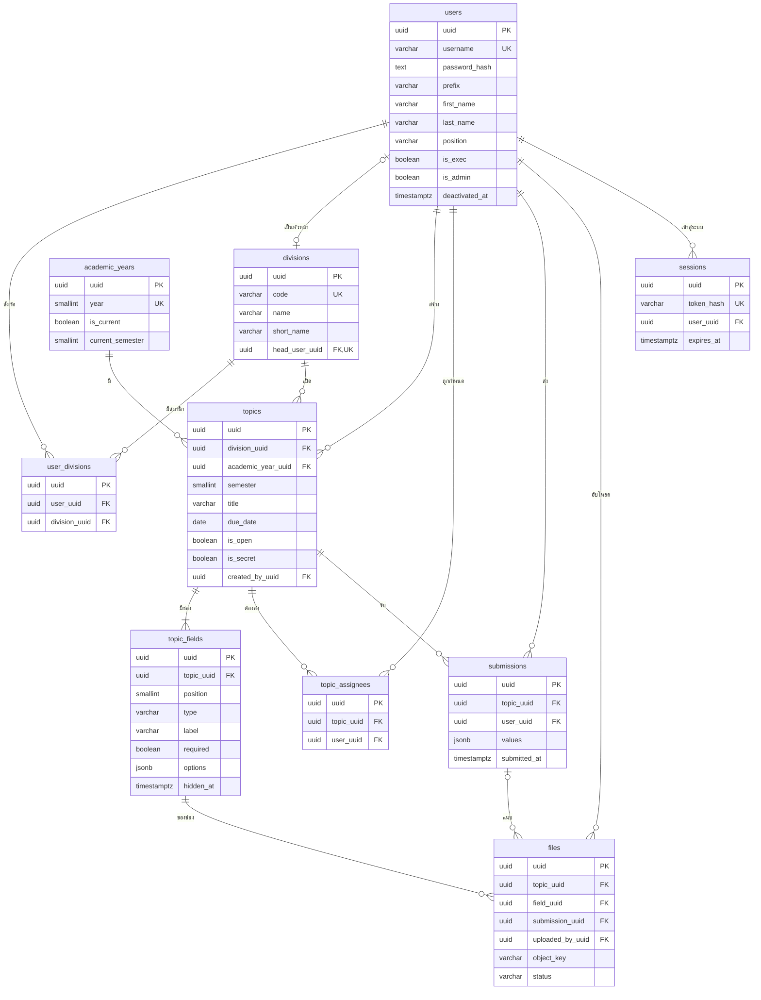

# ฐานข้อมูล SDMS

ER diagram พจนานุกรมข้อมูล และ GORM models ของ SDMS ฝั่ง BE (Go Fiber + PostgreSQL) ตามโครง ฝ่าย → หัวข้อ → คำตอบ

| หัวข้อ | รายละเอียด |
| --- | --- |
| ฐานข้อมูล | PostgreSQL 17 บนเครื่องผ่าน Docker Compose · schema `sdms` |
| ORM | GORM (AutoMigrate) |
| ใช้กับ issue | BE-02 สร้างตาราง + ข้อมูลเริ่มต้น |
| ต้นแบบอ้างอิง | [SDMS Web App](https://claude.ai/artifact/6j9Vof6oUJjZNQWMWueyp2) |

**10** ตาราง · **16** ความสัมพันธ์ (FK) · **7** กติกาที่ฐานข้อมูลคุมให้ · **6** ชนิดช่องในฟอร์ม

> initializer สร้าง schema จาก GORM models บนฐานข้อมูลว่างและรันซ้ำได้โดยไม่สร้างข้อมูลตั้งต้นซ้ำ

## 1. ข้อตกลง

- ทุกตารางอยู่ใน schema `sdms` (ตั้งด้วย `DB_SCHEMA`) และแอปตรวจตอนเริ่มว่า `current_schema()` ตรงกับค่าดังกล่าว
- ชื่อตารางและคอลัมน์เป็น snake_case ตารางเป็นพหูพจน์ ตามค่าเริ่มต้นของ GORM จึงไม่ต้องตั้ง `TableName()`
- ทุกตารางใช้ `uuid` ชนิด PostgreSQL `uuid` เป็น primary key โดยแอปสร้าง UUIDv7 ที่เรียงตามเวลา
- ค่าธรรมชาติ `divisions.code`, `academic_years.year` และ `sessions.token_hash` ยังคงเป็น unique business key
- เวลาเก็บเป็น `timestamptz` ส่วน "วันนี้" และการตัดสินว่าส่งช้าคิดตามเวลาไทย (`Asia/Bangkok`)
- ปีการศึกษาเก็บเป็น พ.ศ. (`2569`) ส่วน `due_date` เก็บเป็น `date` แบบ ค.ศ. แล้วแปลงเป็น พ.ศ. ตอนแสดง
- ไม่ลบบุคลากรจริง ใช้ `deactivated_at` และไม่ embed `gorm.Model` เพราะระบบนี้ไม่ใช้ `deleted_at`
- ตัวไฟล์อยู่ใน Cloudflare R2 หรือ local filesystem ฐานข้อมูลเก็บ object key และข้อมูลของไฟล์

## 2. ER diagram

เส้น `||--o{` อ่านว่า 1 ต่อ 0 หรือหลายแถว · `||--|{` คือ 1 ต่ออย่างน้อย 1 แถว · `|o--o|` คือ 0 หรือ 1 ทั้งสองฝั่ง



## 3. กติกาที่ฐานข้อมูลคุมให้

ถ้าโค้ดพลาด ฐานข้อมูลจะปฏิเสธข้อมูลเหล่านี้เอง ทั้ง 7 ข้อทดสอบแล้วว่าใช้ได้จริง

| กติกา | constraint | รหัส error ของ PostgreSQL → HTTP |
| --- | --- | --- |
| 1 คนส่งคำตอบได้ 1 ชุดต่อหัวข้อ | `uq_submissions_topic_user` | `23505` → 409 |
| ปีการศึกษาปัจจุบันมีได้ปีเดียว | `uq_academic_years_current` | `23505` → 409 |
| 1 คนเป็นหัวหน้าได้ฝ่ายเดียว | `idx_divisions_head_user_uuid` | `23505` → 409 |
| ลบหัวข้อที่มีคำตอบแล้วไม่ได้ | `fk_submissions_topic` (RESTRICT) | `23503` → 409 |
| ชนิดช่องต้องเป็น 1 ใน 6 ชนิด | `chk_topic_fields_type` | `23514` → 400 |
| ไฟล์ขนาด 1 ไบต์ ถึง 50 MB | `chk_files_size` | `23514` → 413 |
| ชื่อผู้ใช้ตามรูปแบบ | `chk_users_username` | `23514` → 400 |

**ที่โค้ดต้องตรวจเอง** (ฐานข้อมูลไม่รู้):

- ตั้งผู้บริหารเป็นหัวหน้าฝ่ายไม่ได้
- เปลี่ยนชนิดของช่องที่มีคำตอบแล้วไม่ได้ (409)
- ช่องตัวเลือกต้องมีอย่างน้อย 2 ข้อ
- ค่าใน `submissions.values` ต้องตรงกับชนิดของช่อง (หัวข้อ 5)
- ส่งได้เฉพาะคนที่อยู่ใน `topic_assignees` และหัวข้อยังเปิดรับ
- ไฟล์ที่แนบต้องเป็นของคนส่ง อยู่หัวข้อเดียวกัน และช่องเดียวกัน

## 4. พจนานุกรมข้อมูล

คอลัมน์ "ว่างได้" ที่มี ✓ คือ `NULL` ได้ ที่เหลือเป็น `NOT NULL`

### บุคลากรและการเข้าสู่ระบบ

#### `users`

บุคลากร 1 แถวต่อ 1 คน ไม่ลบจริง ใช้ deactivated_at แทน

| คอลัมน์ | ชนิด | ว่างได้ | ค่าเริ่มต้น | ความหมาย |
| --- | --- | --- | --- | --- |
| `uuid` | uuid | – | UUIDv7 | รหัสบุคลากร |
| `username` | varchar(32) | – | – | ชื่อผู้ใช้สำหรับเข้าระบบ ตัวพิมพ์เล็ก a–z 0–9 และ . _ - ยาว 3–32 ตัว เช่น somchai.s |
| `password_hash` | text | – | – | hash ของรหัสผ่าน (bcrypt) ห้ามส่งออกทาง API |
| `prefix` | varchar(30) | – | `''` | คำนำหน้า เช่น นาย นาง นางสาว |
| `first_name` | varchar(120) | – | – | ชื่อ |
| `last_name` | varchar(120) | – | `''` | นามสกุล; ว่างได้ในเชิงธุรกิจสำหรับบัญชีระบบ แต่เก็บเป็นข้อความว่างแทน NULL |
| `position` | varchar(120) | – | – | ตำแหน่ง เช่น ครู ภาษาไทย |
| `is_exec` | boolean | – | `false` | ผู้บริหาร: ไม่ต้องส่ง เห็นภาพรวมทุกฝ่าย |
| `is_admin` | boolean | – | `false` | แอดมินกลาง: จัดการบุคลากร ฝ่าย ปีการศึกษา |
| `deactivated_at` | timestamptz | ✓ | – | เวลาที่ปิดใช้งาน ว่าง = ใช้งานอยู่ ปิดแล้วเข้าระบบไม่ได้ แต่คำตอบเดิมยังอยู่ |
| `created_at / updated_at` | timestamptz | ✓ | – | GORM ใส่ให้อัตโนมัติ |

**คีย์และ index**

- PK uuid
- UNIQUE username
- CHECK chk_users_username (รูปแบบชื่อผู้ใช้)
- INDEX deactivated_at

**หมายเหตุ**

- บทบาท "หัวหน้าฝ่าย" ไม่ได้เก็บที่นี่ ดูจาก divisions.head_user_uuid
- ผู้ใช้เปลี่ยนรหัสผ่านเองไม่ได้ แอดมินเป็นคนตั้งให้

#### `sessions`

การเข้าสู่ระบบที่ยังใช้ได้ cookie เก็บ token จริง ตารางเก็บแค่ hash

| คอลัมน์ | ชนิด | ว่างได้ | ค่าเริ่มต้น | ความหมาย |
| --- | --- | --- | --- | --- |
| `uuid` | uuid | – | UUIDv7 | รหัส session |
| `token_hash` | varchar(64) | – | – | sha256 (hex) ของ token ใน cookie |
| `user_uuid` | uuid | – | – | → users.uuid |
| `expires_at` | timestamptz | – | – | หมดอายุ (แนะนำ 30 วัน) |
| `last_seen_at` | timestamptz | – | – | ใช้งานล่าสุด |
| `ip` | varchar(45) | ✓ | – | IP ตอนเข้าสู่ระบบ (รองรับ IPv6) |
| `user_agent` | varchar(300) | ✓ | – | เบราว์เซอร์/อุปกรณ์ |
| `created_at` | timestamptz | ✓ | – | เวลาเข้าสู่ระบบ |

**คีย์และ index**

- PK uuid
- UNIQUE token_hash
- FK user_uuid → users ON DELETE CASCADE
- INDEX user_uuid, expires_at

**หมายเหตุ**

- แอดมินตั้งรหัสใหม่หรือปิดใช้งาน → ลบทุกแถวของคนนั้น
- งานล้างข้อมูลรายวันลบแถวที่ expires_at ผ่านไปแล้ว

### โครงสร้างโรงเรียน

#### `divisions`

ฝ่าย 4 ฝ่าย ข้อมูลตั้งต้น ไม่เพิ่ม/ลบผ่านหน้าเว็บ

| คอลัมน์ | ชนิด | ว่างได้ | ค่าเริ่มต้น | ความหมาย |
| --- | --- | --- | --- | --- |
| `uuid` | uuid | – | UUIDv7 | รหัสหลักของฝ่าย |
| `code` | varchar(8) | – | – | รหัสฝ่าย aca · bud · per · gen ใช้ใน URL |
| `name` | varchar(120) | – | – | ชื่อเต็ม เช่น ฝ่ายบริหารวิชาการ |
| `short_name` | varchar(60) | – | – | ชื่อย่อ เช่น วิชาการ |
| `sort_order` | smallint | – | – | ลำดับการแสดง |
| `head_user_uuid` | uuid | ✓ | – | หัวหน้าฝ่าย → users.uuid ว่าง = ยังไม่ตั้ง |

**คีย์และ index**

- PK uuid
- UNIQUE code
- UNIQUE head_user_uuid (1 คนเป็นหัวหน้าได้ฝ่ายเดียว)
- FK head_user_uuid → users ON DELETE SET NULL

**หมายเหตุ**

- ตั้งผู้บริหารเป็นหัวหน้าฝ่ายไม่ได้ (ตรวจในโค้ด BE-07)

#### `user_divisions`

การสังกัดฝ่าย 1 คนสังกัดได้หลายฝ่าย

| คอลัมน์ | ชนิด | ว่างได้ | ค่าเริ่มต้น | ความหมาย |
| --- | --- | --- | --- | --- |
| `uuid` | uuid | – | UUIDv7 | รหัสการสังกัดฝ่าย |
| `user_uuid` | uuid | – | – | → users.uuid |
| `division_uuid` | uuid | – | – | → divisions.uuid |

**คีย์และ index**

- PK uuid
- UNIQUE (user_uuid, division_uuid)
- FK ทั้งสองคอลัมน์ ON DELETE CASCADE
- INDEX user_uuid, division_uuid

**หมายเหตุ**

- ใช้หาว่าใครต้องส่งหัวข้อของฝ่ายไหน

#### `academic_years`

ปีการศึกษา (พ.ศ.) และภาคเรียนปัจจุบัน

| คอลัมน์ | ชนิด | ว่างได้ | ค่าเริ่มต้น | ความหมาย |
| --- | --- | --- | --- | --- |
| `uuid` | uuid | – | UUIDv7 | รหัสหลักของปีการศึกษา |
| `year` | smallint | – | – | ปีการศึกษา พ.ศ. เช่น 2569 |
| `is_current` | boolean | – | `false` | ปีปัจจุบัน มีได้ปีเดียว |
| `current_semester` | smallint | – | `1` | ภาคเรียนปัจจุบันของปีนี้ (1 หรือ 2) |
| `created_at` | timestamptz | ✓ | – |  |

**คีย์และ index**

- PK uuid
- UNIQUE year
- UNIQUE uq_academic_years_current (is_current) WHERE is_current
- CHECK current_semester IN (1,2)

**หมายเหตุ**

- หัวข้อใหม่รับ year และ semester จากแถวที่ is_current = true
- แอดมินเปลี่ยนภาคเรียนราว พ.ย. และเปลี่ยนปีราว พ.ค.

### หัวข้อและฟอร์ม

#### `topics`

หัวข้อที่ฝ่ายเปิดรับ 1 หัวข้อ = 1 ฟอร์ม

| คอลัมน์ | ชนิด | ว่างได้ | ค่าเริ่มต้น | ความหมาย |
| --- | --- | --- | --- | --- |
| `uuid` | uuid | – | UUIDv7 | รหัสหัวข้อ |
| `division_uuid` | uuid | – | – | ฝ่ายเจ้าของ → divisions.uuid |
| `academic_year_uuid` | uuid | – | – | ปีการศึกษา → academic_years.uuid |
| `semester` | smallint | – | – | ภาคเรียน 1 หรือ 2 (ใส่จากภาคเรียนปัจจุบัน แก้ไม่ได้) |
| `title` | varchar(200) | – | – | ชื่อหัวข้อ |
| `due_date` | date | – | – | กำหนดส่ง (เก็บเป็น ค.ศ. แสดงเป็น พ.ศ.) |
| `is_open` | boolean | – | `true` | เปิดรับอยู่หรือไม่ |
| `is_secret` | boolean | – | `false` | หัวข้อลับ |
| `created_by_uuid` | uuid | – | – | คนสร้าง → users.uuid |
| `closed_at` | timestamptz | ✓ | – | เวลาปิดรับล่าสุด |
| `created_at / updated_at` | timestamptz | ✓ | – |  |

**คีย์และ index**

- PK uuid
- FK division_uuid, academic_year_uuid, created_by_uuid ON DELETE RESTRICT
- INDEX (division_uuid, academic_year_uuid), due_date
- CHECK semester IN (1,2)

**หมายเหตุ**

- ลบหัวข้อที่มีคำตอบแล้วไม่ได้ ฐานข้อมูลกันให้ผ่าน FK ของ submissions

#### `topic_fields`

ช่องในฟอร์มของหัวข้อ เรียงตาม position

| คอลัมน์ | ชนิด | ว่างได้ | ค่าเริ่มต้น | ความหมาย |
| --- | --- | --- | --- | --- |
| `uuid` | uuid | – | UUIDv7 | รหัสช่อง ใช้เป็น key ใน submissions.values |
| `topic_uuid` | uuid | – | – | → topics.uuid |
| `position` | smallint | – | – | ลำดับในฟอร์ม เริ่มที่ 1 |
| `type` | varchar(10) | – | – | text · para · num · date · choice · file |
| `label` | varchar(120) | – | – | ชื่อช่อง เช่น จำนวนชั่วโมง |
| `required` | boolean | – | `true` | ต้องกรอก |
| `options` | jsonb | – | `'[]'` | ตัวเลือก (เฉพาะ choice) อย่างน้อย 2 ข้อ |
| `hidden_at` | timestamptz | ✓ | – | ถูกลบหลังมีคำตอบแล้ว = ซ่อน ไม่ลบจริง |
| `created_at` | timestamptz | ✓ | – |  |

**คีย์และ index**

- PK uuid
- FK topic_uuid → topics ON DELETE CASCADE
- CHECK type IN (6 ชนิด)
- INDEX topic_uuid

**หมายเหตุ**

- เปลี่ยน type ของช่องที่มีคำตอบแล้วไม่ได้ (ตรวจในโค้ด ตอบ 409)
- ลบช่องที่ยังไม่มีคำตอบ = ลบแถวจริง

#### `topic_assignees`

รายชื่อผู้ต้องส่ง บันทึกตอนสร้างหัวข้อ

| คอลัมน์ | ชนิด | ว่างได้ | ค่าเริ่มต้น | ความหมาย |
| --- | --- | --- | --- | --- |
| `uuid` | uuid | – | UUIDv7 | รหัสผู้รับมอบหมาย |
| `topic_uuid` | uuid | – | – | → topics.uuid |
| `user_uuid` | uuid | – | – | → users.uuid |

**คีย์และ index**

- PK uuid
- UNIQUE (topic_uuid, user_uuid)
- FK topic_uuid ON DELETE CASCADE · user_uuid ON DELETE RESTRICT
- INDEX user_uuid

**หมายเหตุ**

- ตอนสร้างหัวข้อ: ใส่ทุกคนที่สังกัดฝ่ายของหัวข้อ ไม่ใช่ผู้บริหาร และยังไม่ถูกปิดใช้งาน
- ครูที่เข้าใหม่หรือย้ายเข้าฝ่ายทีหลังไม่ถูกนับในหัวข้อที่เปิดไปแล้ว
- แนะนำ: เมื่อปิดใช้งานบุคลากร ลบแถวของคนนั้นในหัวข้อที่ยังเปิดและยังไม่ได้ส่ง

### คำตอบและไฟล์

#### `submissions`

คำตอบ 1 ชุด ต่อ 1 คน ต่อ 1 หัวข้อ ส่งซ้ำ = แก้แถวเดิม

| คอลัมน์ | ชนิด | ว่างได้ | ค่าเริ่มต้น | ความหมาย |
| --- | --- | --- | --- | --- |
| `uuid` | uuid | – | UUIDv7 | รหัสคำตอบ |
| `topic_uuid` | uuid | – | – | → topics.uuid |
| `user_uuid` | uuid | – | – | คนส่ง → users.uuid |
| `values` | jsonb | – | `'{}'` | คำตอบทุกช่อง ดูรูปแบบในหัวข้อ "รูปแบบ JSON" |
| `submitted_at` | timestamptz | – | – | ส่งครั้งแรก ไม่เปลี่ยนเมื่อแก้ ใช้ตัดสินว่าช้า |
| `updated_at` | timestamptz | ✓ | – | แก้ล่าสุด |

**คีย์และ index**

- PK uuid
- UNIQUE uq_submissions_topic_user (topic_uuid, user_uuid)
- FK topic_uuid, user_uuid ON DELETE RESTRICT
- INDEX user_uuid

**หมายเหตุ**

- ไม่มีการลบคำตอบทั้งชุด

#### `files`

ไฟล์ 1 ไฟล์ ตัวไฟล์อยู่ใน Cloudflare R2 หรือ local filesystem ตารางเก็บข้อมูลอ้างอิงและ object key

| คอลัมน์ | ชนิด | ว่างได้ | ค่าเริ่มต้น | ความหมาย |
| --- | --- | --- | --- | --- |
| `uuid` | uuid | – | UUIDv7 | รหัสไฟล์ ใช้ใน /api/files/{uuid} |
| `topic_uuid` | uuid | – | – | → topics.uuid |
| `field_uuid` | uuid | – | – | ช่องที่แนบ → topic_fields.uuid |
| `submission_uuid` | uuid | ✓ | – | คำตอบที่ผูก ว่าง = ยังไม่ได้ส่ง (staged) |
| `uploaded_by_uuid` | uuid | – | – | คนอัปโหลด → users.uuid |
| `object_key` | varchar(512) | – | – | key ของ object ใน R2 หรือ path สัมพัทธ์ของ local storage |
| `original_name` | varchar(255) | – | – | ชื่อไฟล์เดิมที่ผู้ใช้อัปโหลด |
| `mime_type` | varchar(120) | – | – | เช่น application/pdf |
| `size_bytes` | bigint | – | – | ขนาด 1 ไบต์ ถึง 50 MB |
| `status` | varchar(10) | – | `'staged'` | staged · attached · trashed |
| `position` | smallint | – | `0` | ลำดับไฟล์ในช่องเดียวกัน |
| `created_at` | timestamptz | ✓ | – | เวลาอัปโหลด |

**คีย์และ index**

- PK uuid
- FK topic_uuid, field_uuid ON DELETE CASCADE · submission_uuid ON DELETE SET NULL · uploaded_by_uuid ON DELETE RESTRICT
- CHECK size_bytes BETWEEN 1 AND 52428800 · status IN (3 ค่า)
- INDEX topic_uuid, submission_uuid, status

**หมายเหตุ**

- ไฟล์ staged ที่อายุเกิน 24 ชั่วโมง → ลบ object จาก storage แล้วตั้ง status = trashed
- เอาไฟล์ออกระหว่างแก้คำตอบ → status = trashed (ไม่ลบแถว)

#### โครงสร้าง object key ใน R2

- รูปแบบ: `<prefix>/<ปีการศึกษา>/<รหัสฝ่าย>/<topic_uuid>/<file_uuid>.<นามสกุล>`
- ค่าเริ่มต้นของ prefix คือ `sdms` และปรับได้ด้วย `R2_PREFIX`
- prefix ใน R2 เป็นส่วนหนึ่งของ object key ไม่ใช่โฟลเดอร์จริง จึงไม่ต้องมีตาราง cache โฟลเดอร์

## 5. รูปแบบ JSON

### topic_fields.options

ใช้เฉพาะช่องชนิด `choice` เป็น array ของข้อความ ช่องชนิดอื่นเป็น `[]`

```json
["ม.1", "ม.2", "ม.3"]
```

### submissions.values

object ที่ key คือ `topic_fields.uuid` (เป็นข้อความ) ช่องที่ไม่ได้กรอกไม่ต้องมี key

```json
{
  "0199d16f-4f09-7c20-8cc7-e8c3363ea1b0": "PLC ชุมชนการเรียนรู้ทางวิชาชีพ",
  "0199d16f-4f09-7c20-8cc7-e8c3363ea1b1": "2026-09-20",
  "0199d16f-4f09-7c20-8cc7-e8c3363ea1b2": 12,
  "0199d16f-4f09-7c20-8cc7-e8c3363ea1b3": "ม.2",
  "0199d16f-4f09-7c20-8cc7-e8c3363ea1b4": ["0199d16f-4f09-7c20-8cc7-e8c3363ea1b5"]
}
```

| ชนิดช่อง | ค่าใน JSON | ตรวจ |
| --- | --- | --- |
| `text` ข้อความ | string | ไม่เกิน 500 ตัวอักษร |
| `para` ข้อความยาว | string | ไม่เกิน 5,000 ตัวอักษร |
| `num` ตัวเลข | number | เป็นตัวเลข รับทศนิยม |
| `date` วันที่ | string `"YYYY-MM-DD"` (ค.ศ.) | เป็นวันที่ที่มีจริง |
| `choice` ตัวเลือก | string | ต้องอยู่ใน `options` |
| `file` ไฟล์ | array ของ `files.uuid` | อย่างน้อย 1 ไฟล์ถ้าต้องกรอก · ไฟล์ต้องเป็นของคนส่ง หัวข้อเดียวกัน ช่องเดียวกัน |

## 6. ค่าที่คำนวณ ไม่ได้เก็บ

ค่าเหล่านี้ขึ้นกับวันที่ปัจจุบันหรือกำหนดส่งที่แก้ได้ จึงคำนวณทุกครั้งที่ query แทนการเก็บลงตาราง

| ค่า | วิธีคำนวณ |
| --- | --- |
| สถานะ **ส่งแล้ว** | มีคำตอบ และวันที่ของ `submitted_at` (เวลาไทย) ≤ `due_date` |
| สถานะ **ช้า** | มีคำตอบ และวันที่ของ `submitted_at` (เวลาไทย) > `due_date` |
| สถานะ **ยังไม่ส่ง** | ไม่มีคำตอบ หัวข้อเปิดรับ และวันนี้ ≤ `due_date` |
| สถานะ **เลยกำหนด** | ไม่มีคำตอบ หัวข้อเปิดรับ และวันนี้ > `due_date` |
| สถานะ **ไม่ส่ง** | ไม่มีคำตอบ และหัวข้อปิดรับแล้ว |
| ส่งแล้ว **x/y** | y = จำนวนแถวใน `topic_assignees` ของหัวข้อ · x = จำนวนคนในนั้นที่มีแถวใน `submissions` |
| บทบาทหัวหน้าฝ่าย | มีแถวใน `divisions` ที่ `head_user_uuid` = ผู้ใช้ |
| จำนวนหัวข้อของแต่ละปี | join `topics.academic_year_uuid` แล้วนับตาม `academic_years.year` |

## 7. ข้อมูลเริ่มต้น

### divisions

| code | name | short_name | sort_order |
| --- | --- | --- | --- |
| `aca` | ฝ่ายบริหารวิชาการ | วิชาการ | 1 |
| `bud` | ฝ่ายบริหารงบประมาณ | งบประมาณ | 2 |
| `per` | ฝ่ายบริหารงานบุคคล | บุคคล | 3 |
| `gen` | ฝ่ายบริหารทั่วไป | ทั่วไป | 4 |

### academic_years

1 แถวสำหรับปีปัจจุบัน เช่น `year = 2569`, `is_current = true`, `current_semester = 1` (ภาคเรียนที่ 1 ราว พ.ค.–ต.ค.)

### แอดมินคนแรก

สร้างด้วยคำสั่งตอน deploy (BE-02) ใส่ `is_admin = true` และรหัสผ่านที่ hash แล้ว ควรมีแอดมินอย่างน้อย 2 คน จะได้ตั้งรหัสใหม่ให้กันได้

## 8. GORM models

โมเดลที่ใช้งานจริงอยู่ใน [`internal/model/models.go`](internal/model/models.go) และ migration สำหรับข้อมูลเดิมอยู่ใน [`internal/migration/uuid_migration.go`](internal/migration/uuid_migration.go)

- ทุก model embed `UUIDModel` ซึ่งสร้าง UUIDv7 อัตโนมัติใน `BeforeCreate`
- ตารางเชื่อม `user_divisions` และ `topic_assignees` มี `uuid` ของตัวเอง พร้อม unique composite key ป้องกันความสัมพันธ์ซ้ำ
- migration เพิ่ม UUIDv7 และ UUID foreign keys ให้แถวเดิมก่อนถอด bigint/natural primary keys
- key ภายใน `submissions.values` ถูกแปลงจาก `topic_fields.id` เดิมเป็น `topic_fields.uuid` โดยคง key ที่ไม่รู้จักไว้เพื่อไม่ทำข้อมูลสูญหาย
- ทุกขั้นตอนทำใน transaction เดียว และรันซ้ำได้
- รายการ model ทั้งหมดอยู่ใน `migration.SchemaModels()` ใช้ทั้งกับ AutoMigrate และการเปิด RLS จึงไม่มีตารางใหม่หลุดการป้องกัน

โครงหลักของ primary key:

```go
type UUIDModel struct {
	UUID uuid.UUID `gorm:"type:uuid;primaryKey" json:"uuid"`
}

func (m *UUIDModel) BeforeCreate(_ *gorm.DB) error {
	if m.UUID != uuid.Nil {
		return nil
	}
	generated, err := uuid.NewV7()
	if err != nil {
		return err
	}
	m.UUID = generated
	return nil
}
```

<details>
<summary>โมเดล legacy ก่อนเปลี่ยนเป็น UUID (เก็บไว้อ้างอิง migration)</summary>

ไฟล์เดิมใช้ `bigint` และ natural primary keys ดังนี้

`internal/model/models.go`

```go
// Package model: GORM models ของ SDMS — ตรงกับพจนานุกรมข้อมูล
package model

import (
	"time"

	"gorm.io/datatypes"
)

// ประเภทช่องในฟอร์ม
const (
	FieldText   = "text"   // ข้อความ
	FieldPara   = "para"   // ข้อความยาว
	FieldNum    = "num"    // ตัวเลข
	FieldDate   = "date"   // วันที่
	FieldChoice = "choice" // ตัวเลือก
	FieldFile   = "file"   // ไฟล์
)

// สถานะไฟล์
const (
	FileStaged   = "staged"   // อัปโหลดแล้ว ยังไม่ได้ผูกกับคำตอบ
	FileAttached = "attached" // ผูกกับคำตอบแล้ว
	FileTrashed  = "trashed"  // ถูกเอาออกและลบ object จาก storage แล้ว
)

// User บุคลากร 1 คน — ไม่ลบจริง ใช้ DeactivatedAt แทน
type User struct {
	ID            uint64     `gorm:"primaryKey"`
	Username      string     `gorm:"size:32;not null;uniqueIndex;check:chk_users_username,username ~ '^[a-z0-9._-]{3,32}$'"`
	PasswordHash  string     `gorm:"not null" json:"-"`
	Prefix        string     `gorm:"size:30;not null;default:''"`
	FirstName     string     `gorm:"size:120;not null"`
	LastName      string     `gorm:"size:120;not null;default:''"`
	FullName      string     `gorm:"-" json:"-"` // ค่าแสดงผลที่ประกอบจาก 3 ช่อง ไม่เก็บซ้ำในฐานข้อมูล
	Position      string     `gorm:"size:120;not null"`
	IsExec        bool       `gorm:"not null;default:false"`
	IsAdmin       bool       `gorm:"not null;default:false"`
	DeactivatedAt *time.Time `gorm:"index"`
	CreatedAt     time.Time
	UpdatedAt     time.Time

	Divisions []Division `gorm:"many2many:user_divisions;joinForeignKey:UserID;joinReferences:DivisionCode"`
}

// Division ฝ่าย 4 ฝ่าย — หัวหน้าฝ่ายละ 1 คน และ 1 คนเป็นหัวหน้าได้ฝ่ายเดียว
type Division struct {
	Code       string  `gorm:"primaryKey;size:8"` // aca | bud | per | gen
	Name       string  `gorm:"size:120;not null"`
	ShortName  string  `gorm:"size:60;not null"`
	SortOrder  int16   `gorm:"not null"`
	HeadUserID *uint64 `gorm:"uniqueIndex"`

	HeadUser *User `gorm:"foreignKey:HeadUserID;constraint:OnDelete:SET NULL"`
}

// UserDivision การสังกัดฝ่าย (1 คนสังกัดได้หลายฝ่าย)
type UserDivision struct {
	UserID       uint64 `gorm:"primaryKey"`
	DivisionCode string `gorm:"primaryKey;size:8;index"`

	User     User     `gorm:"constraint:OnDelete:CASCADE"`
	Division Division `gorm:"foreignKey:DivisionCode;references:Code;constraint:OnDelete:CASCADE"`
}

// AcademicYear ปีการศึกษา (พ.ศ.) — ปีปัจจุบันมีได้ปีเดียว
type AcademicYear struct {
	Year            int16 `gorm:"primaryKey;type:smallint;autoIncrement:false"` // เช่น 2569
	IsCurrent       bool  `gorm:"not null;default:false;uniqueIndex:uq_academic_years_current,where:is_current"`
	CurrentSemester int16 `gorm:"not null;default:1;check:chk_academic_years_semester,current_semester IN (1,2)"`
	CreatedAt       time.Time

	// ประกาศฝั่งนี้เพื่อให้ได้ FK topics.year → academic_years.year
	// (ถ้าประกาศใน Topic ด้วยชื่อ Year ซ้ำกัน GORM จะตีความเป็น has-one ผิดทิศ)
	Topics []Topic `gorm:"foreignKey:Year;references:Year;constraint:OnDelete:RESTRICT"`
}

// Topic หัวข้อที่หัวหน้าฝ่ายเปิดรับ
type Topic struct {
	ID            uint64    `gorm:"primaryKey"`
	DivisionCode  string    `gorm:"size:8;not null;index:idx_topics_division_year,priority:1"`
	Year          int16     `gorm:"type:smallint;not null;index:idx_topics_division_year,priority:2"`
	Semester      int16     `gorm:"not null;check:chk_topics_semester,semester IN (1,2)"`
	Title         string    `gorm:"size:200;not null"`
	DueDate       time.Time `gorm:"type:date;not null;index"`
	IsOpen        bool      `gorm:"not null;default:true"`
	IsSecret      bool      `gorm:"not null;default:false"`
	CreatedByID   uint64    `gorm:"not null"`
	ClosedAt      *time.Time
	CreatedAt     time.Time
	UpdatedAt     time.Time

	Division  Division        `gorm:"foreignKey:DivisionCode;references:Code;constraint:OnDelete:RESTRICT"`
	CreatedBy User            `gorm:"foreignKey:CreatedByID;constraint:OnDelete:RESTRICT"`
	Fields    []TopicField    `gorm:"constraint:OnDelete:CASCADE"`
	Assignees []TopicAssignee `gorm:"constraint:OnDelete:CASCADE"`
}

// TopicField ช่องในฟอร์มของหัวข้อ — ช่องที่มีคำตอบแล้วถูก "ลบ" = ตั้ง HiddenAt
type TopicField struct {
	ID        uint64         `gorm:"primaryKey"`
	TopicID   uint64         `gorm:"not null;index"`
	Position  int16          `gorm:"not null"`
	Type      string         `gorm:"size:10;not null;check:chk_topic_fields_type,type IN ('text','para','num','date','choice','file')"`
	Label     string         `gorm:"size:120;not null"`
	Required  bool           `gorm:"not null;default:true"`
	Options   datatypes.JSON `gorm:"type:jsonb;not null;default:'[]'"` // เฉพาะ choice: ["ม.1","ม.2"]
	HiddenAt  *time.Time
	CreatedAt time.Time
}

// TopicAssignee รายชื่อผู้ต้องส่ง บันทึกตอนสร้างหัวข้อ
type TopicAssignee struct {
	TopicID uint64 `gorm:"primaryKey"`
	UserID  uint64 `gorm:"primaryKey;index"`

	User User `gorm:"constraint:OnDelete:RESTRICT"`
}

// Submission คำตอบ 1 ชุด ต่อ 1 คน ต่อ 1 หัวข้อ
type Submission struct {
	ID          uint64         `gorm:"primaryKey"`
	TopicID     uint64         `gorm:"not null;uniqueIndex:uq_submissions_topic_user,priority:1"`
	UserID      uint64         `gorm:"not null;uniqueIndex:uq_submissions_topic_user,priority:2;index"`
	Values      datatypes.JSON `gorm:"type:jsonb;not null;default:'{}'"` // {"<field_id>": ค่า}
	SubmittedAt time.Time      `gorm:"not null"`                         // ส่งครั้งแรก — ใช้ตัดสิน "ช้า"
	UpdatedAt   time.Time

	Topic Topic  `gorm:"constraint:OnDelete:RESTRICT"`
	User  User   `gorm:"constraint:OnDelete:RESTRICT"`
	Files []File `gorm:"constraint:OnDelete:SET NULL"`
}

// File ไฟล์ 1 ไฟล์ ตัวไฟล์อยู่ใน Cloudflare R2 หรือ local filesystem
type File struct {
	ID           uint64  `gorm:"primaryKey"`
	TopicID      uint64  `gorm:"not null;index"`
	FieldID      uint64  `gorm:"not null"`
	SubmissionID *uint64 `gorm:"index"`
	UploadedByID uint64  `gorm:"not null"`
	ObjectKey    string  `gorm:"size:512;not null"`
	OriginalName string  `gorm:"size:255;not null"`
	MimeType     string  `gorm:"size:120;not null"`
	SizeBytes    int64   `gorm:"not null;check:chk_files_size,size_bytes BETWEEN 1 AND 52428800"`
	Status       string  `gorm:"size:10;not null;default:'staged';index;check:chk_files_status,status IN ('staged','attached','trashed')"`
	Position     int16   `gorm:"not null;default:0"`
	CreatedAt    time.Time

	Topic      Topic      `gorm:"constraint:OnDelete:CASCADE"`
	Field      TopicField `gorm:"foreignKey:FieldID;constraint:OnDelete:CASCADE"`
	UploadedBy User       `gorm:"foreignKey:UploadedByID;constraint:OnDelete:RESTRICT"`
}

// Session การเข้าสู่ระบบ 1 ครั้ง — cookie เก็บ token, ตารางเก็บแค่ hash
type Session struct {
	TokenHash  string    `gorm:"primaryKey;size:64"` // sha256 (hex) ของ token
	UserID     uint64    `gorm:"not null;index"`
	ExpiresAt  time.Time `gorm:"not null;index"`
	LastSeenAt time.Time `gorm:"not null"`
	IP         string    `gorm:"size:45"`
	UserAgent  string    `gorm:"size:300"`
	CreatedAt  time.Time

	User User `gorm:"constraint:OnDelete:CASCADE"`
}
```

**สร้างตาราง**

```go
// สร้างตารางทั้งหมดด้วย AutoMigrate (เรียกตอนเริ่มแอป หรือในคำสั่ง migrate)
func Migrate(db *gorm.DB) error {
	// user_divisions เป็นตารางเชื่อมที่ประกาศเอง ต้องบอก GORM ก่อน AutoMigrate
	if err := db.SetupJoinTable(&model.User{}, "Divisions", &model.UserDivision{}); err != nil {
		return err
	}
	return db.AutoMigrate(
		&model.User{}, &model.Division{}, &model.UserDivision{}, &model.AcademicYear{},
		&model.Topic{}, &model.TopicField{}, &model.TopicAssignee{},
		&model.Submission{}, &model.File{}, &model.Session{},
	)
}
```

> ส่วน legacy นี้ไม่ใช่ schema ปัจจุบัน

</details>

## 9. สิ่งที่ต้องปรับใน BE issues

เอกสารนี้เพิ่มตาราง `topic_assignees` (บันทึกรายชื่อผู้ต้องส่งตอนสร้างหัวข้อ) และระบุตาราง `sessions` ที่ issue ยังไม่ได้เขียนไว้

| Issue | ปรับ |
| --- | --- |
| BE-02 | รายการตารางเพิ่ม `topic_assignees`, `sessions` (รวม 10 ตาราง) |
| BE-05 | ปิดใช้งานหรือตั้งรหัสใหม่ → ลบแถวใน `sessions` ของคนนั้น · แนะนำให้ลบออกจาก `topic_assignees` ของหัวข้อที่ยังเปิดและยังไม่ส่ง |
| BE-08 | สร้างหัวข้อ + ช่อง + `topic_assignees` ใน transaction เดียว |
| BE-10, BE-13, BE-15 | y และแถวในตารางคำตอบนับจาก `topic_assignees` ไม่ใช่สมาชิกฝ่ายในวันนี้ |
| BE-12 | ตรวจว่าคนส่งอยู่ใน `topic_assignees` ของหัวข้อนั้น |
