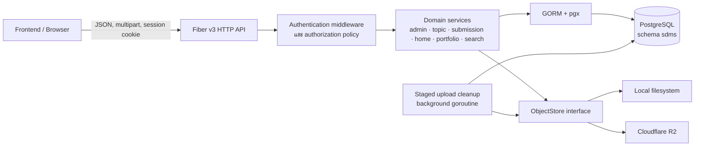
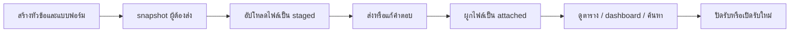

# ภาพรวมระบบ SDMS (School Document Management System)

อัปเดต 20 ต.ค. 2569 จากโค้ดบน `main` commit `7e58d57` (`Update v0.0.3`)

## สถานะปัจจุบัน

SDMS เป็น backend สำหรับคลังเอกสารกลางของโรงเรียน รองรับบุคลากรประมาณ 50–150 คนใน 4 ฝ่าย เป้าหมายคือรวมการขอ ส่ง ติดตาม และค้นหาเอกสารไว้ในระบบเดียวแทนไฟล์ที่กระจายอยู่ตามพื้นที่ส่วนตัว

สถานะ implementation ปัจจุบัน:

- งาน backend ตาม [sdms-be-issues.md](sdms-be-issues.md) เสร็จแล้ว 17/17 งาน
- มี HTTP API 38 routes ครอบคลุม authentication, ผู้ใช้, โครงสร้างโรงเรียน, หัวข้อ, การส่งคำตอบ, ไฟล์, dashboard, portfolio และ search
- ใช้ PostgreSQL schema `sdms` จำนวน 10 ตาราง และใช้ UUIDv7 ในคอลัมน์ primary key ชื่อ `uuid`
- storage สลับได้ระหว่าง local filesystem สำหรับพัฒนาและ Cloudflare R2 สำหรับ production
- `go test ./...` ผ่านทุก package ณ วันที่อัปเดตเอกสารนี้
- พร้อมสำหรับพัฒนาและเชื่อม frontend บนเครื่อง แต่ repo ยังไม่มี deployment/CI configuration และยังไม่ควรตีความว่า production-ready โดยอัตโนมัติ

## ปัญหาที่ระบบแก้

- ไฟล์กระจายอยู่ใน Google Drive หรือพื้นที่ส่วนตัวของแต่ละคน
- ต้องติดตามเอกสารทีละคนและไม่เห็นสถานะรวม
- เตรียมเอกสารย้อนหลังเพื่อประเมินหรือรายงานได้ยาก
- ค้นเอกสารเก่าจากชื่อหัวข้อ ผู้ส่ง คำตอบ หรือชื่อไฟล์ได้ไม่สะดวก

แนวคิดหลักคือให้หัวหน้าฝ่ายหรือแอดมินสร้าง “หัวข้อ” เป็นแบบฟอร์ม ระบบ snapshot รายชื่อผู้ต้องส่งในขณะสร้าง บุคลากรกรอกข้อมูลและแนบไฟล์ จากนั้นผู้มีสิทธิ์ดูสถานะและคำตอบผ่านตารางเดียว

## สถาปัตยกรรม



โค้ดแบ่งความรับผิดชอบเป็นชั้นหลักดังนี้:

| ส่วน | หน้าที่ |
| --- | --- |
| `cmd/api` | โหลด config, เปิด database/storage, ประกอบ services, รัน HTTP server และ graceful shutdown |
| `internal/server` | กำหนด routes, bind request/response, middleware และแปลง error เป็น JSON contract กลาง |
| `internal/auth`, `authorization` | login/logout/session, profile และกฎสิทธิ์ส่วนกลาง |
| `internal/admin`, `topic`, `submission`, `home`, `portfolio`, `search` | business logic แยกตาม use case โดยไม่ผูกกับ Fiber |
| `internal/upload` | upload lifecycle, download authorization และ adapter สำหรับ local/R2 |
| `internal/model`, `migration`, `database` | GORM models, schema/seed และการเชื่อม PostgreSQL |

## ผู้ใช้และสิทธิ์

บทบาทซ้อนกันได้ ผู้ใช้หนึ่งคนสังกัดได้หลายฝ่าย แต่เป็นหัวหน้าได้สูงสุด 1 ฝ่าย แต่ละฝ่ายมีหัวหน้าได้ 1 คน และผู้บริหารเป็นหัวหน้าฝ่ายไม่ได้

| บทบาท | หน้าที่ส่ง | สิทธิ์หลัก |
| --- | --- | --- |
| บุคลากร | ส่งหัวข้อที่ตนอยู่ใน snapshot ผู้ต้องส่ง | ดูหัวข้อทั่วไปและคำตอบทุกแถว · หัวข้อลับเห็นเฉพาะแถวตนเอง · ดู/แก้คำตอบของตนขณะหัวข้อเปิด · ใช้แฟ้มส่วนตัวและค้นหา |
| หัวหน้าฝ่าย | ส่งเหมือนบุคลากรถ้าอยู่ใน snapshot | สร้างและจัดการหัวข้อของฝ่ายตน · ดูทุกคำตอบในหัวข้อลับของฝ่าย · ดูรายชื่อค้างและสถิติฝ่าย |
| ผู้บริหาร | ไม่ถูกเพิ่มเป็นผู้ต้องส่ง | ดูทุกคำตอบรวมถึงหัวข้อลับ · ดูสถิติได้ทุกฝ่าย |
| แอดมิน | ส่งตามฝ่ายที่สังกัดและ snapshot | จัดการผู้ใช้ รหัสผ่าน หัวหน้าฝ่าย และปีการศึกษา · สร้าง/จัดการหัวข้อได้ทุกฝ่าย |

กฎสิทธิ์ที่ควรทราบ:

- `is_admin` เพียงอย่างเดียวไม่ได้ให้สิทธิ์อ่านคำตอบลับทุกหัวข้อ แอดมินจะเห็นทุกแถวของหัวข้อลับเมื่อเป็นผู้สร้าง เป็นหัวหน้าฝ่ายเจ้าของหัวข้อ หรือมีบทบาทผู้บริหาร
- ผู้สร้างหัวข้อยังแก้ ปิด/เปิด และลบหัวข้อเดิมได้ แม้ภายหลังไม่ได้เป็นหัวหน้าฝ่ายนั้นแล้ว
- หัวข้อทั่วไปเปิดให้ผู้ใช้ที่ login แล้วดูตารางคำตอบทุกแถว แม้ไม่ได้สังกัดฝ่ายนั้น
- การดูไฟล์ใช้ขอบเขตสิทธิ์เดียวกับการดูแถวคำตอบ และ API ไม่เปิดเผย local path, R2 object key, URL หรือ credential
- การดูสถิติรายฝ่ายอนุญาตเฉพาะผู้บริหารหรือหัวหน้าฝ่ายนั้น แอดมินที่ไม่มี content role ไม่ได้สิทธิ์เพิ่มโดยอัตโนมัติ

## วงจรของหัวข้อและการส่งเอกสาร



1. หัวหน้าฝ่ายหรือแอดมินสร้างหัวข้อในปีและภาคเรียนปัจจุบัน พร้อมกำหนดส่ง ระดับความลับ และฟอร์มอย่างน้อย 1 ช่อง
2. ระบบบันทึก `topic_assignees` จากสมาชิกที่ยังเปิดใช้งานในฝ่ายนั้น โดยไม่รวมผู้บริหาร รายชื่อชุดนี้ไม่เปลี่ยนตามสมาชิกฝ่ายในภายหลัง
3. ผู้ที่อยู่ใน snapshot อัปโหลดไฟล์ไปยัง field ชนิด `file` ได้ขณะหัวข้อเปิด ไฟล์ยังเป็น `staged` จนกว่าจะถูกอ้างในคำตอบ
4. `PUT my-submission` เป็น upsert: ครั้งแรกสร้างคำตอบ ครั้งถัดไปแก้คำตอบเดิม โดยคง `submitted_at` ครั้งแรกไว้และเปลี่ยน `updated_at`
5. การผูก/ถอดไฟล์เกิดใน transaction เดียวกับคำตอบ ไฟล์ที่ถอดออกถูกลบจาก storage และเปลี่ยนเป็น `trashed`
6. หัวข้อปิดและเปิดใหม่ได้ การปิดกันการส่ง/แก้คำตอบใหม่ ส่วนคำตอบและไฟล์เดิมยังอ่านได้ตามสิทธิ์
7. ลบหัวข้อได้เฉพาะหัวข้อที่ยังไม่มี submission เพื่อป้องกันข้อมูลการส่งสูญหาย

สถานะต่อผู้ใช้คำนวณจาก `submitted_at` ครั้งแรก, `due_date`, `is_open` และวันที่ตาม `Asia/Bangkok`:

| API status | ความหมาย |
| --- | --- |
| `submitted` | ส่งครั้งแรกภายในวันกำหนดส่ง |
| `late` | ส่งครั้งแรกหลังวันกำหนดส่ง ขณะที่หัวข้อยังเปิดรับ |
| `pending` | ยังไม่ส่งและยังไม่เลยวันกำหนดส่ง |
| `overdue` | ยังไม่ส่ง เลยกำหนดแล้ว แต่หัวข้อยังเปิดรับ |
| `not_submitted` | หัวข้อปิดรับแล้วโดยไม่มีคำตอบ |

วันกำหนดส่งยังถือว่าส่งทันจนจบวันนั้นตามเวลาไทย

## ความสามารถที่ implement แล้ว

| กลุ่ม | ความสามารถปัจจุบัน |
| --- | --- |
| Authentication | username/password, bcrypt, server-side session, HttpOnly cookie, logout และ `/me` |
| ผู้ใช้ | เพิ่ม/แก้/ปิด-เปิดบัญชี, reset password, directory บุคลากร, import CSV/XLSX สูงสุด 2,000 แถวแบบ all-or-nothing และ template ดาวน์โหลด |
| โครงสร้างโรงเรียน | 4 ฝ่ายตั้งต้น, ตั้งหัวหน้าฝ่าย, สร้างและสลับปี/ภาคเรียนปัจจุบัน |
| หัวข้อและฟอร์ม | สร้าง/แก้/ปิด/เปิด/ลบหัวข้อ, หัวข้อลับ, field 6 ชนิด และรักษาประวัติ field ที่มีคำตอบแล้วด้วยการซ่อนแทนลบ |
| การส่งคำตอบ | รายการงานค้าง, ดูคำตอบตนเอง, upsert คำตอบ, validation รายช่อง และสถานะตามเวลาไทย |
| ตารางติดตาม | 1 แถวต่อ assignee, ค่า `null` สำหรับช่องที่ยังไม่ตอบ, กรอง done/pending และคัดรายชื่อผู้ยังไม่ส่งตามสิทธิ์ |
| ไฟล์ | staged upload, จำกัด 50 MiB ต่อไฟล์, local/R2, cleanup, inline preview สำหรับ PDF/ภาพ raster/วิดีโอ และบังคับ download ได้ |
| Dashboard | ตัวเลขส่วนตัว, งานค้าง, 5 การส่งล่าสุด, สรุปรายฝ่าย และภาพรวมสำหรับหัวหน้าฝ่าย/ผู้บริหาร โดยนับเฉพาะหัวข้อเปิด |
| แฟ้มของฉัน | ประวัติทุกปีรวมหัวข้อปิด, ค้นชื่อหัวข้อ/คำตอบ/ชื่อไฟล์ และ stream ZIP รายปีหรือทั้งหมด |
| ค้นหากลาง | ค้นหัวข้อ ฝ่าย ผู้ส่ง ค่าในคำตอบ และชื่อไฟล์; กรองฝ่าย/ปี/ภาค/ผู้ส่ง; pagination และบังคับ secret scope ก่อนนับผล |

## HTTP API

ทุก route ใช้ prefix `/api` และตอบ error รูปแบบเดียวกัน:

```json
{
  "code": "VALIDATION_ERROR",
  "message": "Request validation failed",
  "details": {}
}
```

ยกเว้น health, login และ logout route อื่นต้องมี session cookie ที่ถูกต้อง

| กลุ่ม | Routes |
| --- | --- |
| ระบบและ auth | `GET /health` · `POST /auth/login` · `POST /auth/logout` |
| Profile และข้อมูลอ้างอิง | `GET /me` · `GET /users` · `GET /years` |
| หัวข้อ | `POST /topics` · `PATCH /topics/:uuid` · `POST /topics/:uuid/close` · `POST /topics/:uuid/reopen` · `DELETE /topics/:uuid` · `GET /divisions` · `GET /divisions/:code/topics` |
| Upload และไฟล์ | `POST /uploads` · `DELETE /uploads/:uuid` · `GET /files/:uuid` |
| การส่งคำตอบ | `GET /me/pending` · `GET /topics/:uuid` · `GET /topics/:uuid/my-submission` · `PUT /topics/:uuid/my-submission` · `GET /topics/:uuid/pending-names` |
| Dashboard | `GET /home` · `GET /divisions/:code/stats` |
| แฟ้มของฉัน | `GET /me/submissions` · `GET /me/files.zip` |
| ค้นหา | `GET /search` |
| Admin ผู้ใช้ | `GET /admin/users` · `POST /admin/users` · `POST /admin/users/import` · `GET /admin/users/import/template.csv` · `GET /admin/users/import/template.xlsx` · `PATCH /admin/users/:uuid` · `POST /admin/users/:uuid/password` |
| Admin โครงสร้าง | `GET /admin/divisions` · `PUT /admin/divisions/:code/head` · `GET /admin/years` · `POST /admin/years` · `POST /admin/years/:year/current` |

รายละเอียด request/response และ acceptance criteria ราย route อยู่ใน [README.md](README.md) และ [sdms-be-issues.md](sdms-be-issues.md)

## แบบฟอร์มและข้อจำกัดข้อมูล

ฟอร์มรองรับ 6 ชนิด:

| Type | รูปแบบค่า |
| --- | --- |
| `text` | string สูงสุด 500 ตัวอักษร |
| `para` | string สูงสุด 5,000 ตัวอักษร |
| `num` | JSON number ที่เป็น finite number |
| `date` | string รูปแบบ `YYYY-MM-DD` |
| `choice` | string ที่ต้องตรงกับหนึ่งใน options |
| `file` | array ของ file UUID ที่อัปโหลดไว้ใน field เดียวกัน |

ข้อจำกัดสำคัญ:

- หัวข้อหนึ่งมีได้สูงสุด 100 fields
- `choice` มี 2–100 options และค่าซ้ำแบบไม่สนตัวพิมพ์ไม่ได้
- ไฟล์ต้องมีขนาด 1 byte ถึง 50 MiB; request body ของ Fiber เผื่อ multipart overhead เพิ่ม 2 MiB
- ไฟล์ `staged` ที่ไม่ได้ผูกกับ submission จะถูก cleanup ตาม `STAGED_UPLOAD_TTL` ค่าเริ่มต้น 24 ชั่วโมง รอบละไม่เกิน 100 ไฟล์
- คำค้น portfolio/search ยาวได้สูงสุด 200 ตัวอักษร
- search ใช้ page size เริ่มต้น 20 และสูงสุด 100 รายการ พร้อม topic matches สูงสุด 20 รายการ
- username ใช้ `a-z`, `0-9`, `.`, `_`, `-` ความยาว 3–32 ตัวอักษร; password ใช้ได้ 8–72 bytes

## ฐานข้อมูล

ระบบใช้ 10 ตารางใน PostgreSQL schema `sdms`:

| กลุ่ม | ตาราง |
| --- | --- |
| บัญชีและ session | `users`, `sessions` |
| โครงสร้างโรงเรียน | `divisions`, `user_divisions`, `academic_years` |
| หัวข้อและผู้ต้องส่ง | `topics`, `topic_fields`, `topic_assignees` |
| คำตอบและไฟล์ | `submissions`, `files` |

ข้อกำหนดหลักถูกคุมทั้งใน service และ database constraints เช่น username ไม่ซ้ำ, ปีปัจจุบันมีได้หนึ่งปี, ผู้ใช้หนึ่งคนเป็นหัวหน้าได้หนึ่งฝ่าย, คำตอบหนึ่งชุดต่อคนต่อหัวข้อ และ assignee หนึ่งรายการต่อคนต่อหัวข้อ

`go run ./cmd/migrate` ใช้ `AutoMigrate` เพื่อสร้าง schema ใหม่และ seed 4 ฝ่ายกับปี/ภาคเรียนปัจจุบัน คำสั่งรันซ้ำกับ schema รูปแบบปัจจุบันได้ แต่ migration ชุดนี้ออกแบบสำหรับฐานข้อมูลใหม่ ไม่ใช่ระบบ versioned migration สำหรับแปลง production schema รุ่นเก่า

ดู ER diagram และ data dictionary ที่ [sdms-database.md](sdms-database.md)

## Authentication และความปลอดภัยที่มีในโค้ด

- password เก็บด้วย bcrypt และ login ใช้ dummy hash เมื่อไม่พบ username เพื่อลด username enumeration จาก timing
- session token สุ่ม 32 bytes; browser ได้ opaque token แต่ฐานข้อมูลเก็บเฉพาะ SHA-256 hash
- cookie เป็น `HttpOnly`, `SameSite=Lax`, path `/`; เปิด `Secure` ผ่าน `SESSION_COOKIE_SECURE`
- session มี absolute TTL ค่าเริ่มต้น 24 ชั่วโมง และอัปเดต `last_seen_at` ไม่เกินหนึ่งครั้งต่อ 5 นาที
- logout, reset password และการปิดบัญชียกเลิก session ฝั่ง server
- บัญชีที่ปิดใช้งาน login ไม่ได้ และถูกนำออกจากหัวข้อเปิดที่ยังไม่เคยส่ง โดยไม่ลบ submission เก่า
- unknown errors ตอบข้อความ 500 แบบทั่วไปและเก็บรายละเอียดไว้ใน server log
- Fiber recovery middleware ป้องกัน panic ทำให้ process ตอบ JSON 500 แทนการหลุดออกจาก request flow
- query สำคัญใช้ transaction/row lock และ read endpoint ที่ต้องให้ยอดกับรายการตรงกันใช้ repeatable-read snapshot
- local storage ป้องกัน path traversal; R2 จำกัด object key ให้อยู่ใต้ configured prefix

## เทคโนโลยีและ runtime

| ส่วน | ปัจจุบัน |
| --- | --- |
| ภาษา | Go 1.25 |
| HTTP framework | Fiber v3.5 |
| ORM / driver | GORM v1.31 + pgx v5 |
| ฐานข้อมูล | PostgreSQL 17; local instance ผ่าน Docker Compose |
| Object storage | local filesystem (ค่าเริ่มต้น) หรือ Cloudflare R2 ผ่าน AWS SDK v2 |
| Spreadsheet | Excelize สำหรับ import/template XLSX |
| Authentication | username/password + server-side session cookie |
| Frontend | ไม่ได้อยู่ใน repository นี้; product design เดิมวางไว้เป็น Next.js/TypeScript |
| Production hosting | ยังไม่ได้กำหนดหรือ encode ไว้ใน repository; Cloudflare ที่ใช้อยู่ในโค้ดหมายถึง R2 storage ไม่ใช่หลักฐานว่า Go API deploy บน Cloudflare |

## Configuration

`config.Load` อ่าน `.env` แล้วให้ process environment มีลำดับความสำคัญสูงกว่า ค่าและ default ดูได้จาก [.env.example](.env.example)

| กลุ่ม | ตัวแปรหลัก |
| --- | --- |
| Server | `SERVER_HOST`, `SERVER_PORT` หรือ `PORT` |
| Database | `DATABASE_URL` หรือชุด `DB_HOST`, `DB_PORT`, `DB_USER`, `DB_PASSWORD`, `DB_NAME`; รวม `DB_SCHEMA` และ connection pool settings |
| Session | `SESSION_TTL`, `SESSION_COOKIE_NAME`, `SESSION_COOKIE_SECURE` |
| Storage | `FILE_STORAGE_DRIVER=local|r2`, `LOCAL_UPLOAD_DIR`, `STAGED_UPLOAD_TTL`, `UPLOAD_CLEANUP_INTERVAL` |
| R2 | `R2_ACCOUNT_ID`, `R2_ACCESS_KEY_ID`, `R2_SECRET_ACCESS_KEY`, `R2_BUCKET`, `R2_PREFIX`, `R2_SESSION_TOKEN`, `R2_ENDPOINT` |

เมื่อ start API ระบบ ping PostgreSQL และตรวจว่า `current_schema()` ตรงกับ `DB_SCHEMA`; ถ้า schema ยังไม่มีหรือ `search_path` ผิด API จะไม่เริ่มรับ request

## การรันบนเครื่อง

ต้องมี Go 1.25 และ Docker จากนั้นใช้ลำดับนี้:

```powershell
Copy-Item .env.example .env
docker compose up -d
go run ./cmd/migrate
go run ./cmd/create-admin -username admin -password '<อย่างน้อย 8 ตัวอักษร>' -first-name 'ผู้ดูแลระบบ' -position 'ผู้ดูแลระบบ'
go run ./cmd/api
```

API ฟังที่ `http://localhost:8081` ตามค่า default และตรวจ liveness ได้ที่ `GET /api/health`

รันทดสอบด้วย:

```powershell
go test ./...
```

เพื่อไม่ให้รหัสผ่านอยู่ใน shell history ควรกำหนด `INITIAL_ADMIN_USERNAME`, `INITIAL_ADMIN_PASSWORD`, `INITIAL_ADMIN_FIRST_NAME` และ `INITIAL_ADMIN_POSITION` แล้วเรียก `go run ./cmd/create-admin` โดยไม่ส่ง flag

## ขอบเขตที่ยังไม่มีและจุดที่ต้องตัดสินใจก่อน production

ความสามารถที่ตั้งใจไม่ทำใน scope ปัจจุบัน:

- ไม่มี notification; ผู้มีสิทธิ์ใช้รายชื่อผู้ยังไม่ส่งไปแจ้งภายนอกเอง
- ผู้ใช้เปลี่ยนรหัสผ่านเองไม่ได้ แอดมินเป็นผู้ reset ให้
- ไม่มีระดับ “งาน” ใต้ฝ่าย มีเพียง ฝ่าย → หัวข้อ
- รองรับโรงเรียนเดียว ไม่มี tenant, branding หรือ school settings

ช่องว่างเชิงปฏิบัติการที่พบจาก repository:

- ยังไม่มี Dockerfile สำหรับ API, deployment manifest, CI/CD, metrics/tracing, centralized logging configuration หรือ production runbook
- ยังไม่มี OpenAPI/Swagger contract และไม่มี generated client
- `server.New` ยังไม่ได้ติดตั้ง CORS middleware; deployment ปัจจุบันจึงควรให้ frontend เรียกแบบ same-origin/reverse proxy หรือเพิ่ม policy ที่ชัดเจนก่อนแยก origin
- health endpoint เป็น liveness (`{"status":"ok"}`) และไม่ query database หลัง startup; ถ้าต้องการ readiness ต้องมี endpoint/health check แยก
- ยังไม่มี rate limiting หรือกลไกป้องกัน brute-force login ในตัว application
- migration เป็น initializer สำหรับฐานข้อมูลใหม่ ไม่ใช่ชุด migration ที่ version และ rollback ได้
- มี `internal/sampledata` และ `sample-data/users.json` แต่ไม่มี `cmd/seed-sample` ใน tree ปัจจุบัน แม้ README จะอ้างถึงคำสั่งนี้
- ต้องกำหนด production hosting, TLS/reverse proxy, R2 account/bucket, secret rotation, backup/restore และ retention policy ก่อนใช้งานจริง

## เอกสารที่เกี่ยวข้อง

- [README.md](README.md) — รายละเอียด API และ acceptance criteria ของงาน backend
- [sdms-database.md](sdms-database.md) — ER diagram, data dictionary และรูปแบบ JSON ของ 10 ตาราง
- [sdms-be-issues.md](sdms-be-issues.md) — สถานะและรายละเอียดงาน backend 17 รายการ
- [Prototype หน้าจอระบบ](https://claude.ai/artifact/6j9Vof6oUJjZNQWMWueyp2) — ต้นแบบ product/UI ที่เอกสารเดิมใช้อ้างอิง
