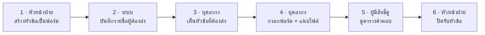

# เอกสารระบบ SDMS (School Document Management System)

อัปเดต 11 ต.ค. 2569

## ภาพรวมระบบ

SDMS คือคลังเอกสารกลางของโรงเรียน ใช้รวบรวมและจัดเก็บเอกสารของบุคลากร 50–150 คนใน 4 ฝ่าย ให้อยู่ที่เดียว และรู้ทันทีว่าใครส่งแล้ว ใครยังไม่ส่ง

**ปัญหาที่ต้องแก้**

- ไฟล์กระจายอยู่ใน Google Drive ส่วนตัวของแต่ละคน
- ต้องตามทวงเอกสารทีละคน และไม่รู้ว่าใครส่งแล้วหรือยัง
- เตรียมเอกสารประกอบการประเมินยาก
- หาเอกสารเก่าไม่เจอ

**แนวคิดหลัก** — ระบบต้องไม่ใช่ Google Drive อีกตัว หน้าแรกเป็นบอร์ดรวมคำขอเอกสารที่เปิดรับอยู่ หัวหน้าฝ่ายสร้างหัวข้อเป็นแบบฟอร์ม บุคลากรกรอกและแนบไฟล์ ผู้ดูเห็นตารางรายชื่อพร้อมคำตอบของแต่ละคน ยึดหน้าตาตาม [Prototype](https://claude.ai/artifact/6j9Vof6oUJjZNQWMWueyp2)

## ผู้ใช้งานและสิทธิ์

มี 4 บทบาท ซ้อนกันได้ เช่น แอดมินเป็นครูในฝ่ายวิชาการด้วย คนหนึ่งสังกัดได้หลายฝ่าย ส่วนหัวหน้าฝ่ายมีได้ฝ่ายละ 1 คน และผู้บริหารเป็นหัวหน้าฝ่ายไม่ได้

| บทบาท | ต้องส่งเอกสารไหม | ทำอะไรได้ |
| --- | --- | --- |
| บุคลากร (ครู / เจ้าหน้าที่) | ส่งทุกหัวข้อของฝ่ายที่ตนสังกัด | ดูหัวข้อและคำตอบได้ทุกฝ่าย ยกเว้นหัวข้อลับ (เห็นแค่ของตัวเอง) · แฟ้มของฉัน · ค้นหา |
| หัวหน้าฝ่าย | ส่งเหมือนบุคลากร | สร้าง แก้ ปิด/เปิดรับ ลบหัวข้อของฝ่ายตน · เห็นคำตอบทุกคนในหัวข้อลับของฝ่ายตน · ดูสถิติฝ่ายตน · คัดลอกชื่อคนที่ยังไม่ส่ง |
| ผู้บริหาร | ไม่ต้องส่ง | เห็นทุกหัวข้อ รวมหัวข้อลับ · ดูสถิติทุกฝ่าย |
| แอดมิน | ส่งตามฝ่ายที่สังกัด | จัดการบัญชีและรหัสผ่านทุกคน · นำเข้าบุคลากรจาก Excel/CSV · ตั้งหัวหน้าฝ่ายและปีการศึกษา · สร้าง/แก้หัวข้อได้ทุกฝ่าย |

## ระบบทำงานอย่างไร

หัวหน้าฝ่ายเปิดหัวข้อ 1 หัวข้อ ระบบรู้เองว่าใครต้องส่ง และทุกคนเห็นสถานะในตารางเดียว จึงไม่ต้องตามทวงทีละคน

1. **หัวหน้าฝ่ายสร้างหัวข้อเป็นฟอร์ม** — ตั้งชื่อ กำหนดส่ง ลับหรือไม่ลับ เลือกช่องได้ 6 ชนิด
2. **ระบบบันทึกรายชื่อผู้ต้องส่ง** — ทุกคนที่สังกัดฝ่ายนั้น ไม่รวมผู้บริหาร
3. **บุคลากรเห็นหัวข้อที่ต้องส่ง** — ขึ้นบนหน้าแรก เรียงตามกำหนดส่งที่ใกล้สุด
4. **บุคลากรกรอกฟอร์ม + แนบไฟล์** — ไฟล์เก็บใน Cloudflare R2 ส่งซ้ำได้ = แก้คำตอบเดิม
5. **ผู้มีสิทธิ์ดูเปิดตารางคำตอบ** — 1 แถวต่อคน พร้อมสถานะ คัดลอกชื่อคนที่ยังไม่ส่งได้
6. **หัวหน้าฝ่ายปิดรับหัวข้อ** — ก่อนปิด ส่งช้าได้ (ติดป้าย "ช้า") หลังปิด คนที่ไม่ส่ง = ไม่ส่ง

สถานะของแต่ละคนในตารางมี 5 แบบ ระบบคำนวณเองจากวันที่ส่ง กำหนดส่ง และการปิดรับ

| สถานะ | เมื่อไร |
| --- | --- |
| ส่งแล้ว | ส่งครั้งแรกภายในวันกำหนดส่ง |
| ช้า | ส่งครั้งแรกหลังวันกำหนดส่ง แต่ก่อนปิดรับ |
| ยังไม่ส่ง | ยังไม่ส่ง และยังไม่ถึงกำหนด |
| เลยกำหนด | ยังไม่ส่ง เลยกำหนดแล้ว แต่หัวข้อยังเปิดรับ |
| ไม่ส่ง | หัวข้อปิดรับแล้วโดยไม่มีคำตอบ |

## หน้าจอหลัก

ระบบมี 8 หน้าหลัก ทุกคนใช้หน้าเดียวกัน แต่เห็นข้อมูลต่างกันตามบทบาท

| หน้า | ใครใช้ | มีอะไร |
| --- | --- | --- |
| หน้าแรก | ทุกคน | หัวข้อที่ต้องส่ง · ตัวเลขของฉัน (ส่งแล้ว / ยังไม่ส่ง / เลยกำหนด) · ส่งล่าสุด 5 รายการ · ผู้บริหารและหัวหน้าฝ่ายเห็นกราฟภาพรวมทั้งโรงเรียนและแยก 4 ฝ่าย |
| หน้าฝ่าย | ทุกคน | รายการหัวข้อของฝ่าย ที่เปิดรับขึ้นก่อน · จำนวนส่งแล้ว x/y และสถานะของฉัน · เลือกดูปีการศึกษาเก่าได้ |
| หน้าหัวข้อ | ทุกคน | ตาราง 1 แถวต่อผู้ต้องส่ง 1 คอลัมน์ต่อช่องฟอร์ม · กรองส่งแล้ว/ยังไม่ส่ง · เปิดดูไฟล์ในเบราว์เซอร์ |
| ส่งเอกสาร | ผู้ต้องส่ง | กรอกฟอร์มของหัวข้อและแนบไฟล์ · กลับมาแก้ได้ขณะหัวข้อยังเปิดรับ |
| สร้าง / แก้หัวข้อ | หัวหน้าฝ่าย แอดมิน | ตัวสร้างฟอร์ม 6 ชนิดช่อง: ข้อความ ข้อความยาว ตัวเลข วันที่ ตัวเลือก ไฟล์ · ตั้งกำหนดส่งและหัวข้อลับ |
| แฟ้มของฉัน | ทุกคน | ทุกอย่างที่เคยส่ง แยกตามปีการศึกษา · ค้นได้ · ดาวน์โหลดรวมเป็น .zip |
| ค้นหา | ทุกคน | ค้นจากชื่อหัวข้อ ฝ่าย ผู้ส่ง ค่าที่กรอก ชื่อไฟล์ · กรองตามฝ่าย ปี ภาคเรียน ผู้ส่ง |
| จัดการระบบ | แอดมิน | บุคลากร (เพิ่มทีละคน นำเข้า Excel/CSV ปิดใช้งาน ตั้งรหัสใหม่) · หัวหน้าฝ่าย · ปีการศึกษา |

## กติกาสำคัญ

- คำตอบ 1 ชุดต่อคนต่อหัวข้อ ส่งซ้ำ = แก้คำตอบเดิม วันที่ส่งครั้งแรกไม่เปลี่ยน
- รายชื่อผู้ต้องส่งบันทึกตอนสร้างหัวข้อ = ทุกคนที่สังกัดฝ่ายนั้น ไม่รวมผู้บริหารและคนที่ปิดใช้งาน
- ส่งช้าได้ตราบที่หัวข้อยังเปิดรับ แต่ติดป้าย "ช้า" (นับวันตามเวลาไทย)
- หัวข้อผูกกับปีการศึกษาปัจจุบันอัตโนมัติ ภาคเรียนคิดจากวันที่: พ.ค.–ต.ค. = ภาค 1 · พ.ย.–เม.ย. = ภาค 2
- ไฟล์ละไม่เกิน 50 MB เปิดดูผ่านระบบเท่านั้น ไม่เปิดเผย R2 URL หรือ credentials ให้ผู้ใช้
- คนที่ออกแล้วใช้ "ปิดใช้งาน" แทนการลบ คำตอบเดิมยังอยู่

**สิ่งที่ระบบไม่ทำ**

- ไม่มีการแจ้งเตือน — หัวหน้าฝ่ายใช้ปุ่มคัดลอกชื่อคนที่ยังไม่ส่งไปแจ้งเอง
- ผู้ใช้เปลี่ยนรหัสผ่านเองไม่ได้ แอดมินเป็นคนตั้งให้
- ไม่มีระดับ "งาน" ใต้ฝ่าย มีแค่ ฝ่าย → หัวข้อ
- ใช้กับโรงเรียนเดียว ไม่ต้องตั้งค่าชื่อ โลโก้ สี หรือโดเมนของโรงเรียน

## เทคโนโลยี

| ส่วน | ใช้อะไร |
| --- | --- |
| Backend | Go (Fiber) + GORM |
| Frontend | Next.js (TypeScript) |
| ฐานข้อมูล | PostgreSQL 17 · 10 ตารางใน model ปัจจุบัน |
| ที่รันระบบ | Cloudflare |
| เก็บไฟล์ | Cloudflare R2 แยก object key ตาม ปี / ฝ่าย / หัวข้อ |
| เข้าสู่ระบบ | Username + Password · session cookie |
| โค้ด | GitHub repo ส่วนตัว · ติดตามงานด้วย GitHub Projects |

**คำถามที่ยังเปิดอยู่**

- production จะใช้ R2 account และ bucket ใด รวมถึงผู้รับผิดชอบการหมุน access key?
- ใช้ฐานข้อมูล PostgreSQL ของโปรเจกต์เดิมร่วมกัน หรือแยกฐานใหม่?

## เอกสารที่เกี่ยวข้อง

- [Prototype หน้าจอระบบ](https://claude.ai/artifact/6j9Vof6oUJjZNQWMWueyp2) — ต้นแบบที่เอกสารนี้ยึด
- [sdms-database.md](sdms-database.md) — ER diagram และรายละเอียด 10 ตาราง
- [sdms-be-issues.md](sdms-be-issues.md) — งาน BE 17 ข้อแบบ GitHub issue เรียงตามลำดับที่ควรทำ
